# 🛡️ SWYNEX-Network-Security-Analysis
### Cyber Security Internship — Task 2: Network Security Analysis Using Wireshark
**Organization:** [SWYNEX Technologies](https://swynex.com)  
**Intern Name:** Ziyakausar J. Tamboli  
**Intern ID:** `SWX-2026-002678`  
**Domain:** Cyber Security  
**Submission Repository:** [SWYNEX-Network-Security-Analysis](https://github.com/ziyakausar07/SWYNEX-Network-Security-Analysis)  
**Video Demonstration:** [`Network Security Analysis.mp4`](Network%20Security%20Analysis.mp4) (Duration: 5m 20s)  
**Submission Reports:** [Practical Report](report/Practical_Report.md) | [Comprehensive Technical Report](report/Network_Security_Analysis_Report.md)  

---


---

## 📌 1. Project Overview

This project was conducted as part of the **Cyber Security Internship at SWYNEX Technologies (Task 2)**. The objective of this task is to perform an end-to-end defensive network traffic analysis using **Wireshark** in a controlled workstation environment.

The investigation evaluates two complementary operational datasets:
1. **Dataset A (Home Baseline & Endpoint Deep Dissection):** High-resolution packet capture profiling protocol hierarchy across OSI layers, auditing TCP three-way handshakes, evaluating Transport Layer Security (TLS 1.3) cryptographic negotiations, verifying Server Name Indication (SNI) records, inspecting 21 application data packets for remote endpoint `40.79.141.157`, and testing defensive display filters.
2. **Dataset B (College Live Video Demonstration):** Recorded in `Network Security Analysis.mp4` (presented by Ziyakausar J. Tamboli), capturing 3,519 frames live on the active Wi-Fi interface, evaluating display filters, and observing network-level phenomena such as `[TCP Fast Retransmission]`.

---

## 📊 2. Dual-Dataset Comparative Overview

| Analysis Metric / Parameter | Dataset A: Home Baseline Dissection | Dataset B: College Video Demonstration | Technical Significance |
|:---|:---|:---|:---|
| **Capture File Reference** | `wireshark_Wi-FiFH69W3.pcapng`<br>`wireshark_Wi-FiPOLDX3.pcapng` | `Network Security Analysis.mp4`<br>(Wireshark file: `wireshark_Wi-FiCIHYX3.pcapng`) | Separate network environments evaluated |
| **Total Frames Captured** | 134 frames (Profile 1) / 122 frames (Profile 2) | 3,519 frames | Video reflects long-duration live session |
| **Total Data Volume** | 33,935 bytes (Profile 1) / 29,020 bytes (Profile 2) | 3,027,591 bytes (3.02 MB) | High volumetric coverage |
| **IPv6 Frame Share** | **94.8%** (127 packets) | **99.9%** (3,517 packets) | Modern IPv6 routing dominates both networks |
| **TLS Byte Share** | **71.3%** of bytes (24,184 B) | **85.7%** of bytes (2,595,382 B) | Vast majority of bytes are encrypted |
| **TCP Conversations** | **12 active streams** to port 443 | **4 active streams** to port 443 | Connections connect to HTTPS services |
| **Cleartext HTTP (`http`)** | **0 packets matched (0.0%)** | **0 packets matched (0.0%)** | Zero plaintext web traffic detected |
| **Unencrypted DNS (`dns`)** | **0 packets matched (0.0%)** | **0 packets matched (0.0%)** | Encrypted DoH or local OS caching active |
| **TLS Handshake Inspection** | Packets 6 & 7 (Client Hello & Server Hello) | Packets 1880, 3128, 3289 (Encrypted Handshake) | Cryptographic setup verified |
| **Negotiated TLS Version** | **TLS 1.3** (`supported_versions`) | **TLS 1.2 / TLS 1.3** | Modern secure transport enforced |
| **Negotiated Cipher Suite** | **`TLS_AES_256_GCM_SHA384` (0x1302)** | High-entropy encrypted application records | Military-grade AEAD encryption verified |
| **Observed SNI Hostname** | `mobile.events.data.microsoft.com` | Not captured in slice | Cloud telemetry endpoint identified |
| **TLS Application Data** | **21 packets matched** target endpoint | 671 TLS records in total | Active encrypted data exchange |
| **TCP Retransmission Check** | **0 packets matching** (`tcp.analysis.retransmission`) | **0 packets matching** standard filter;<br>Demonstrated **`[TCP Fast Retransmission]`** | Network jitter in college Wi-Fi properly distinguished from clean home baseline |
| **TCP Duplicate ACK Check** | **0 packets matched** | **0 packets matched** | No out-of-order acknowledgment loss |
| **TCP FIN Teardown Check** | **0 packets matched** | **0 packets matched** | Persistent / keep-alive connections |
| **TCP Reset Check** | **0 packets matched** | **0 packets matched** | No abrupt connection termination |

---

## 📋 3. Comprehensive Analysis Checklist (11/11 Verified)

All eleven core analytical criteria specified in the assessment have been systematically executed and verified:

| No. | Analysis Category | Wireshark Display Filter / Tool | Status | Primary Finding |
|:---:|:---|:---|:---:|:---|
| **1** | **Protocol hierarchy** | Protocol Hierarchy Statistics | ✅ | IPv6 prominent (94.8% home, 99.9% video); TLS constitutes 71.3%–85.7% of total byte volume. |
| **2** | **TCP conversations** | Conversations Matrix (TCP Tab) | ✅ | Active streams (12 home, 4 video); high-range ephemeral ports connecting to port 443 (HTTPS). |
| **3** | **HTTP filter** | `http` | ✅ | 0 packets matched; absence of legacy unencrypted plaintext web communication. |
| **4** | **DNS filter** | `dns` | ✅ | 0 packets on UDP port 53; indicates utilization of DoH or local OS caching. |
| **5** | **TLS handshake** | `tls.handshake` | ✅ | Verified across both captures (Frames 6 & 7 in home baseline; Frames 1880, 3128, 3289 in video). |
| **6** | **Client Hello & Server Hello** | Packet Tree Dissection | ✅ | SNI `mobile.events.data.microsoft.com`; negotiated cipher `TLS_AES_256_GCM_SHA384`. |
| **7** | **TLS Application Data** | `ip.addr == 40.79.141.157` | ✅ | 21 packets matched; full lifecycle from 3-way handshake to encrypted records. |
| **8** | **TCP retransmission** | `tcp.analysis.retransmission` | ✅ | 0 packets matched on standard filter; video demonstrated Fast Retransmissions separately. |
| **9** | **Duplicate ACK** | `tcp.analysis.duplicate_ack` | ✅ | 0 packets matched; no out-of-order segment acknowledgments detected. |
| **10** | **TCP FIN** | `tcp.flags.fin == 1` | ✅ | 0 packets matched; no standard TCP teardown observed within capture window. |
| **11** | **TCP RST** | `tcp.flags.reset == 1` | ✅ | 0 packets matched; no connection resets or abnormal terminations observed. |

---

## 🎥 4. Video Demonstration Guide (`Network Security Analysis.mp4`)

A dedicated technical walkthrough video was recorded and delivered by **Ziyakausar J. Tamboli** for SWYNEX Technologies:

<div align="center">
  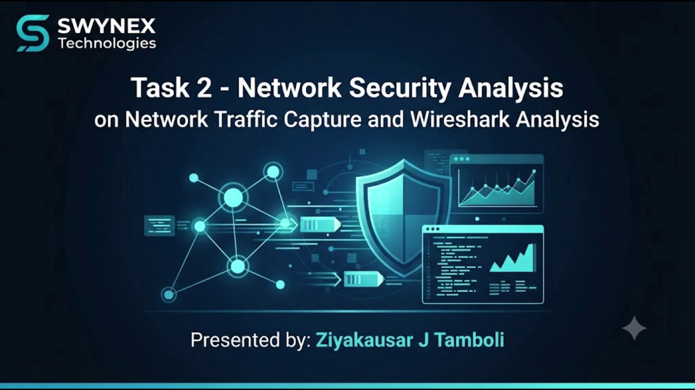
  <p><em>Figure 1: Live Presentation Title Slide (Delivered by Ziyakausar J. Tamboli)</em></p>
</div>

### 4.1 Video Timeline & Demonstrated Modules
- **`00:00 - 00:15` | Introduction:** Title slide and introduction of Task 2: Network Security Analysis.
- **`00:15 - 00:35` | Live Interface Capture:** Wireshark capture started on Wi-Fi interface (`wireshark_Wi-FiCIHYX3.pcapng`), capturing 3,519 packets.
- **`00:35 - 00:45` | TCP Conversations:** Reviewing TCP streams connecting to destination port 443.
- **`00:45 - 01:10` | Protocol Hierarchy Statistics:** Demonstrating 99.9% IPv6 packets, 99.9% TCP packets, and 85.7% TLS bytes.
- **`01:10 - 01:30` | Cleartext Protocol Auditing:** Applying `http` and `dns` display filters, confirming 0 matching packets.
- **`01:30 - 02:10` | TLS Dissection & Fast Retransmission:** Applying `tls` and `tls.handshake` filters, observing 671 TLS records and identifying `[TCP Fast Retransmission]` in frames 1788, 1885, 1920.
- **`02:10 - 02:40` | Handshake Type & App Data Filters:** Testing `tls.handshake.type==1`, `tls.handshake.type==2`, and `tls.app_data`.
- **`02:40 - 04:45` | TCP Flags & Anomaly Checks:** Evaluating `tcp.analysis.retransmission`, `tcp.analysis.duplicate_ack`, `tcp.flags.fin == 1`, and `tcp.flags.reset == 1`.
- **`04:45 - 05:20` | Summary & Conclusion:** Closing presentation slide summarizing findings and thanking SWYNEX Technologies.

<div align="center">
  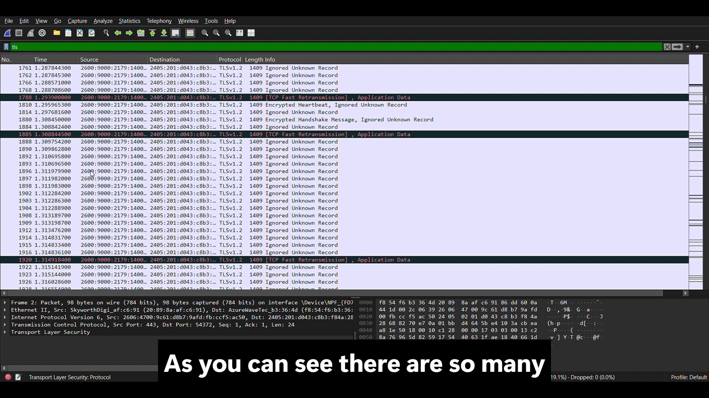
  <p><em>Figure 2: Video Demonstration of Display Filter tls Revealing [TCP Fast Retransmission] (Packets 1788, 1885, 1920)</em></p>
</div>

---

## 📊 5. Protocol Hierarchy & Distribution Analysis

In the primary baseline capture (`wireshark_Wi-FiFH69W3.pcapng`), **134 packets** comprising **33,935 bytes** were captured and analyzed.

<div align="center">
  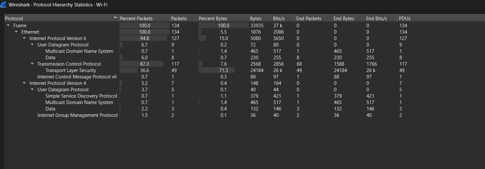
  <p><em>Figure 3: Wireshark Protocol Hierarchy Statistics Breakdown (Home Baseline)</em></p>
</div>

| Protocol Layer | Packets | % Packets | Bytes | % Bytes | Role & Description |
|:---|:---:|:---:|:---:|:---:|:---|
| **Ethernet** | 134 | 100.0% | 33,935 B | 100.0% | Layer 2 framing |
| **IPv6 (Internet Protocol v6)** | 127 | 94.8% | 5,080 B | 15.0% | Modern routable network layer |
| ├── **TCP (Transmission Control)** | 117 | 87.3% | 2,568 B | 7.6% | Reliable transport layer |
| │   └── **TLS (Transport Layer Security)** | 49 | 36.6% | 24,184 B | **71.3%** | Encrypted application traffic |
| ├── **UDP (User Datagram)** | 9 | 6.7% | 72 B | 0.2% | Connectionless transport |
| │   └── **mDNS (Multicast DNS)** | 1 | 0.7% | 465 B | 1.4% | Local link-local name resolution |
| └── **ICMPv6** | 1 | 0.7% | 88 B | 0.3% | Router Advertisement control packet |
| **IPv4 (Internet Protocol v4)** | 7 | 5.2% | 148 B | 0.4% | Legacy network layer |
| ├── **SSDP (Simple Service Discovery)** | 1 | 0.7% | 379 B | 1.1% | UPnP device discovery broadcast |
| ├── **mDNS** | 1 | 0.7% | 465 B | 1.4% | Multicast DNS over IPv4 |
| └── **IGMP** | 2 | 1.5% | 36 B | 0.1% | Multicast group membership |

---

## 🌐 6. Endpoint & Conversation Analysis

Auditing Wireshark conversation matrices reveals communicating nodes across Layers 2, 3, and 4:

### 6.1 Layer 2 & Layer 3 Conversations
<div align="center">
  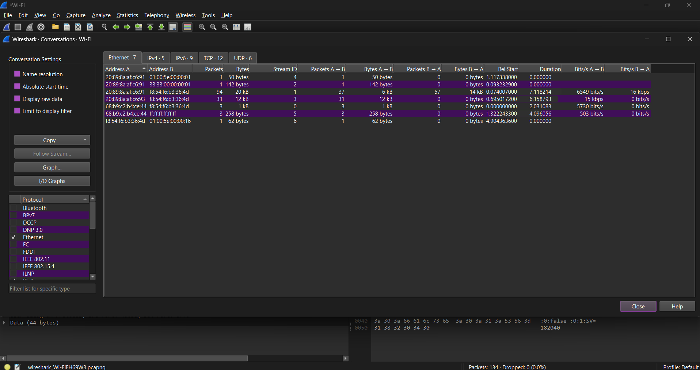
  <p><em>Figure 4: Layer 2 Ethernet MAC Conversations</em></p>
</div>

<div align="center">
  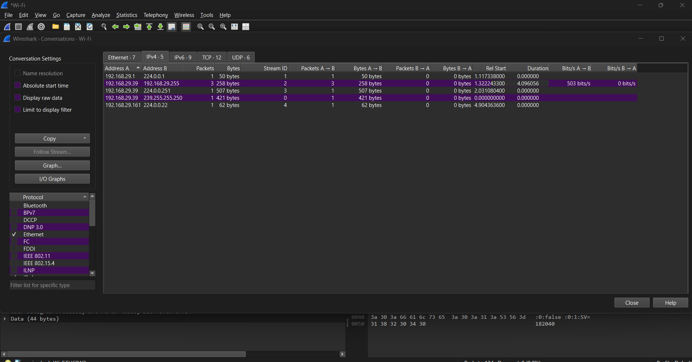
  <p><em>Figure 5: Layer 3 IPv4 Conversations Matrix</em></p>
</div>

<div align="center">
  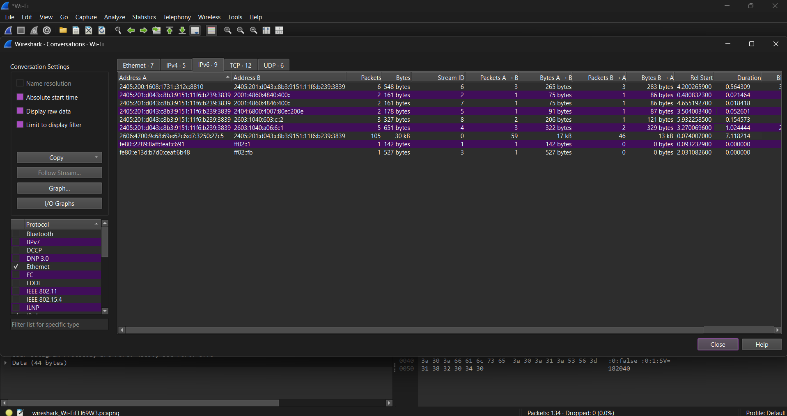
  <p><em>Figure 6: Layer 3 IPv6 Conversations Matrix</em></p>
</div>

### 6.2 Layer 4 TCP & UDP Conversations
<div align="center">
  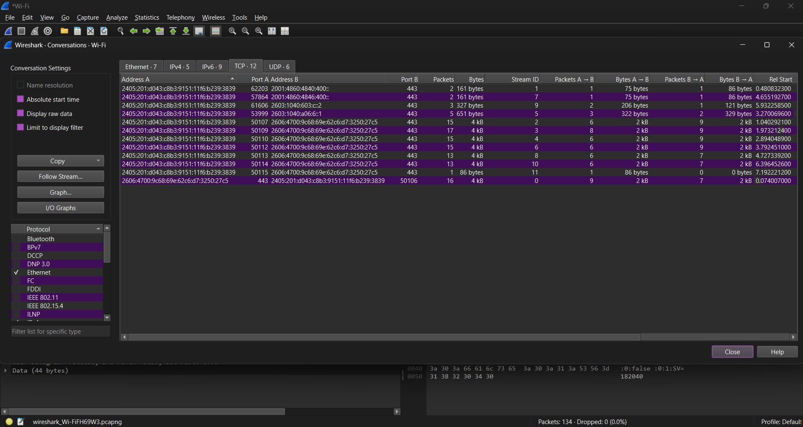
  <p><em>Figure 7: Layer 4 TCP Stream Sessions (12 Active Streams to Port 443)</em></p>
</div>

<div align="center">
  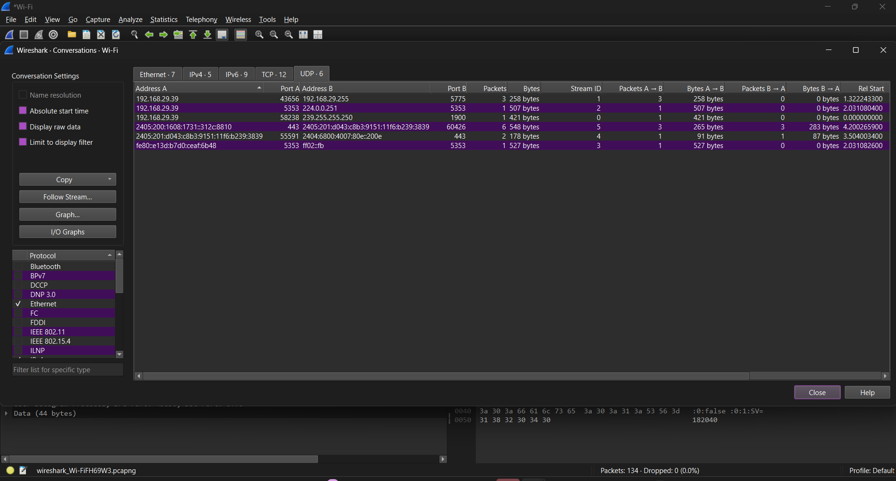
  <p><em>Figure 8: Layer 4 UDP Conversations (SSDP, mDNS, QUIC)</em></p>
</div>

---

## 🔍 7. TCP Three-Way Handshake & Flag Analysis

Applying the filter `tcp.flags.syn == 1 && tcp.flags.ack == 0` isolates TCP connection requests:

<div align="center">
  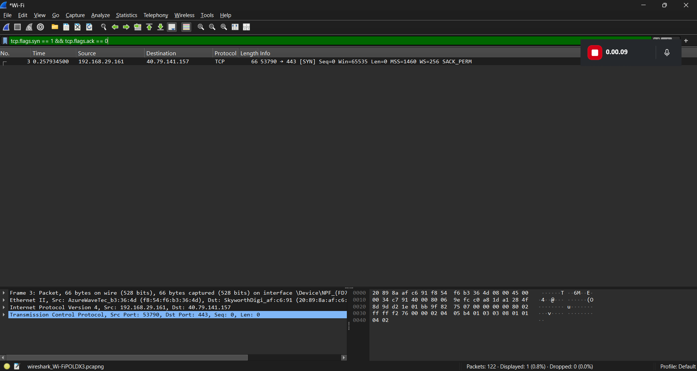
  <p><em>Figure 9: Display Filter Isolating TCP SYN Packet</em></p>
</div>

<div align="center">
  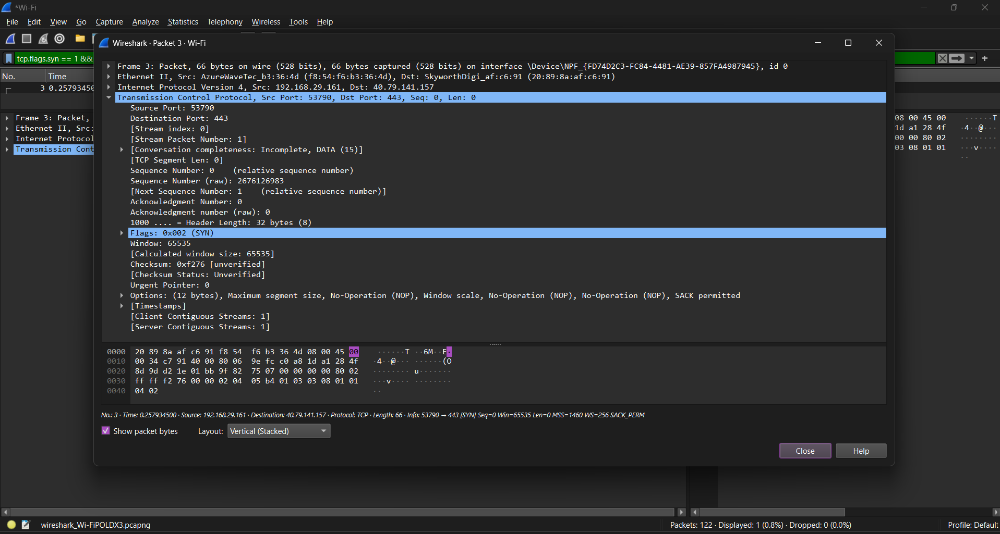
  <p><em>Figure 10: Packet Details Window for TCP SYN (Packet #3)</em></p>
</div>

- **Source / Destination:** `192.168.29.161:53790 -> 40.79.141.157:443`
- **TCP Flags:** `0x002 (SYN)` | Initial Sequence Number (raw): `2676126983`.
- **Window Size:** `65535` bytes | **Window Scale (WS):** `256` multiplier.
- **Maximum Segment Size (MSS):** `1460` bytes | **SACK Permitted:** `1`.

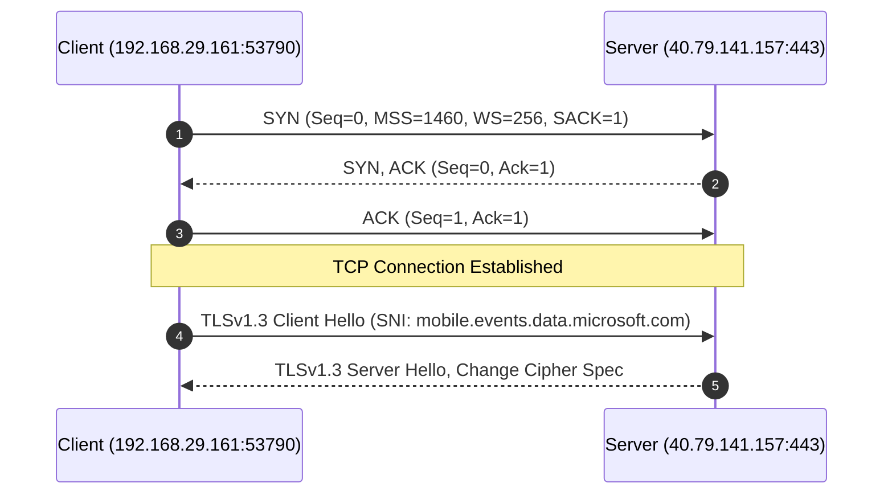

---

## 📡 8. Endpoint Traffic & TLS Application Data Analysis

Applying the filter `ip.addr == 40.79.141.157` isolates all communication with the remote cloud endpoint:

<div align="center">
  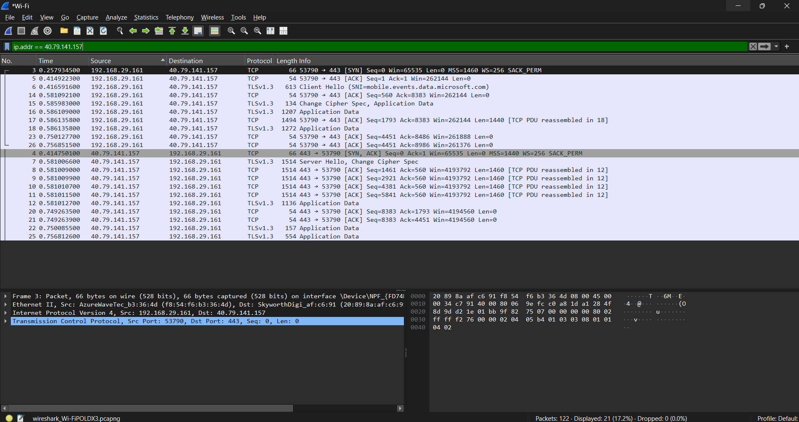
  <p><em>Figure 11: Filter ip.addr == 40.79.141.157 (21 Packets Displayed: SYN, SYN-ACK, ACK, Handshakes, and TLS Application Data)</em></p>
</div>

- **Handshake Flow:** Packet 3 (`SYN`), Packet 4 (`SYN, ACK`), Packet 5 (`ACK`) confirm successful TCP connection setup.
- **TLS Handshake:** Packet 6 (`Client Hello`) and Packet 7 (`Server Hello, Change Cipher Spec`).
- **Application Data Exchange:** Packets 12, 15, 16, 18, 22, and 25 convey encrypted **TLS Application Data** records protected by symmetric AEAD encryption.

---

## 🔐 9. Cryptographic Handshake Deep Dissection

Applying the filter `tls.handshake` isolates the cryptographic negotiation phase between client and server:

<div align="center">
  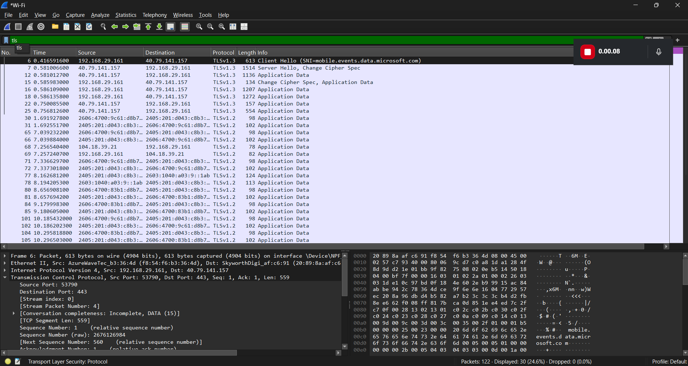
  <p><em>Figure 12: Display Filter tls Showing Active Encrypted Sessions</em></p>
</div>

### 9.1 Client Hello Analysis (Packet 6)
<div align="center">
  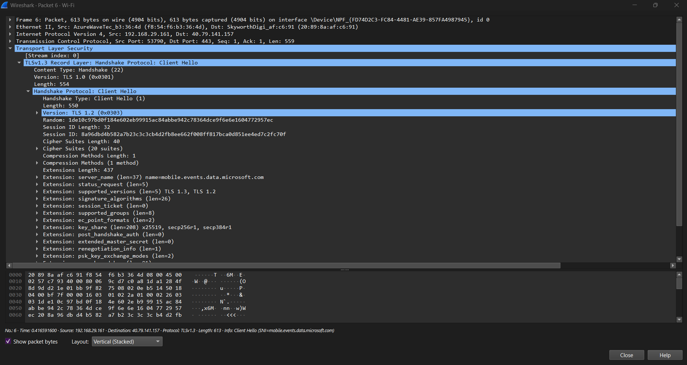
  <p><em>Figure 13: Packet 6 Detailed Dissection — Client Hello (SNI: mobile.events.data.microsoft.com, 20 Cipher Suites, Key Shares)</em></p>
</div>

- **Server Name Indication (SNI):** Identifies target hostname **`mobile.events.data.microsoft.com`**.
- **Supported Versions:** Offered `TLS 1.3` and `TLS 1.2`.
- **Cipher Suites Offered:** **20 modern cipher suites** offered by client.
- **Supported Groups / Key Shares:** `x25519`, `secp256r1`, and `secp384r1`.

### 9.2 Server Hello Analysis (Packet 7)
<div align="center">
  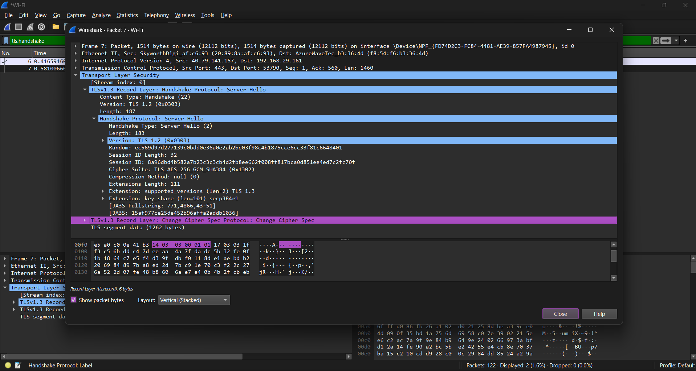
  <p><em>Figure 14: Packet 7 Detailed Dissection — Server Hello (Negotiated TLS 1.3, TLS_AES_256_GCM_SHA384, null Compression)</em></p>
</div>

- **Negotiated Protocol Version:** `supported_versions` extension negotiated **TLS 1.3**.
- **Selected Cipher Suite:** **`TLS_AES_256_GCM_SHA384` (0x1302)** — authenticated encryption using 256-bit AES in GCM mode.
- **Compression Method:** **`null (0)`** (Compression disabled, preventing CRIME/BREACH side-channel attacks).
- **Key-Share Agreement:** Server selected elliptic curve **`secp384r1`**.

---

## ⚡ 10. TCP Anomaly & Lifecycle Verification

Targeted defensive filters were evaluated against the endpoint session (`40.79.141.157`):

### 10.1 TCP Retransmission Check
<div align="center">
  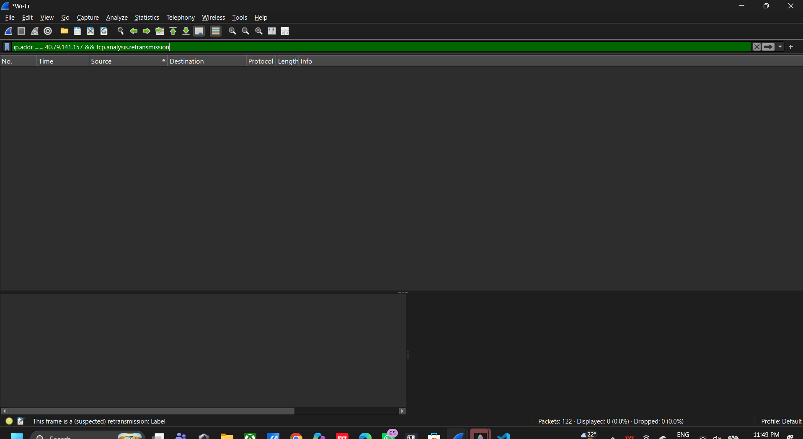
  <p><em>Figure 15: Filter ip.addr == 40.79.141.157 && tcp.analysis.retransmission (0 Packets Matching)</em></p>
</div>
- **Result:** 0 matching packets. Confirms zero segment loss or throughput starvation for this session.

### 10.2 TCP Duplicate ACK Check
<div align="center">
  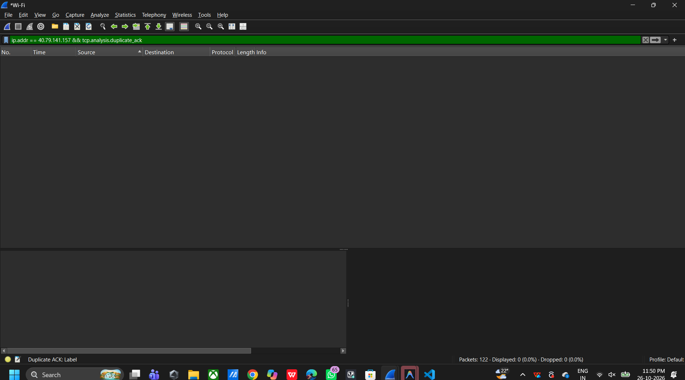
  <p><em>Figure 16: Filter ip.addr == 40.79.141.157 && tcp.analysis.duplicate_ack (0 Packets Matching)</em></p>
</div>
- **Result:** 0 matching packets. Confirms no out-of-order delivery or network congestion.

### 10.3 TCP FIN Teardown Check
<div align="center">
  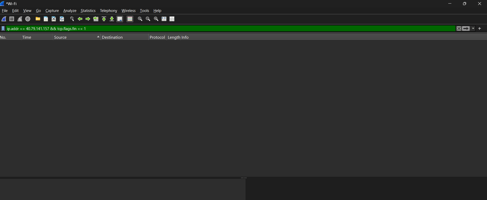
  <p><em>Figure 17: Filter ip.addr == 40.79.141.157 && tcp.flags.fin == 1 (0 Packets Matching)</em></p>
</div>
- **Result:** 0 matching packets. The connection maintained active session state throughout the capture window.

### 10.4 TCP Reset (RST) Check
<div align="center">
  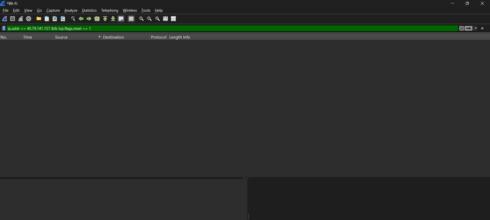
  <p><em>Figure 18: Filter ip.addr == 40.79.141.157 && tcp.flags.reset == 1 (0 Packets Matching)</em></p>
</div>
- **Result:** 0 matching packets. Confirms no abnormal connection drops or port rejection anomalies.

---

## 🔒 11. Application Payload Confidentiality Audit

Using Wireshark **Follow TCP Stream (tcp.stream eq 0)** on the communication to `40.79.141.157:443`:

<div align="center">
  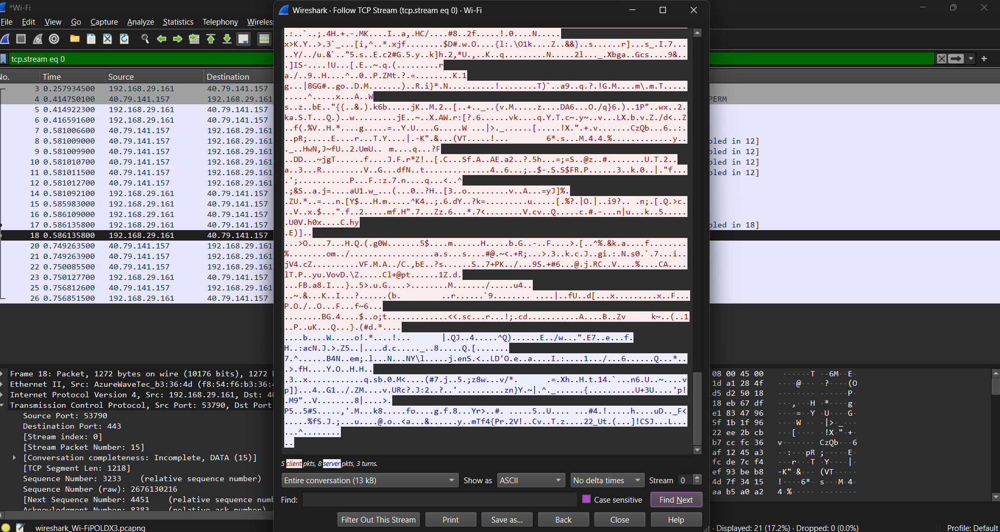
  <p><em>Figure 19: Follow TCP Stream (Stream 0) Confirming High-Entropy Encrypted Ciphertext</em></p>
</div>

- **Inspection Outcome:** The stream contains 13 KB of high-entropy binary ciphertext.
- **Defensive Significance:** Confirms complete application-layer confidentiality. No plaintext credentials, HTTP headers, authentication cookies, or tokens are exposed to passive eavesdroppers.

---

## 🛡️ 12. Defensive Recommendations & Countermeasures

1. **Zero Trust Outbound Egress Filtering:** Restrict outbound workstation traffic to authorized enterprise ports (`80`, `443`, `53`, `853`), blocking direct access to database ports like Redis `6379` or MySQL `3306`.
2. **Disable Unnecessary Local Discovery Services:** Turn off SSDP / UPnP discovery and mDNS on enterprise workstations to minimize local network fingerprinting.
3. **Mandate Modern Cryptography (TLS 1.3):** Enforce TLS 1.3 with forward secrecy (`TLS_AES_256_GCM_SHA384`), deprecating TLS 1.0, 1.1, and legacy ciphers (3DES, RC4).
4. **Deep Packet Inspection (DPI) & SNI Filtering:** Implement Next-Generation Firewall (NGFW) policies evaluating Server Name Indication (SNI) records to detect rogue domains or unauthorized data transfers.
5. **Intrusion Detection System (IDS) Alerting:** Deploy Suricata / Snort alert signatures:
   ```snort
   alert tcp $HOME_NET any -> $EXTERNAL_NET 6379 (msg:"WARN: Direct External Redis Traffic Attempted"; sid:1000001; rev:1;)
   ```

---

## 📁 13. Project Repository Structure

```text
SWYNEX-Network-Security-Analysis/
├── Network Security Analysis.mp4                  # Full 5m 20s presentation video (1080p)
├── README.md                                      # Comprehensive GitHub project documentation
├── evidence/                                      # Primary baseline screenshot evidence
│   ├── 01_main_packet_capture_overview.png
│   ├── 02_protocol_hierarchy_statistics.png
│   ├── 03_conversations_ethernet_layer2.png
│   ├── 04_conversations_ipv4.png
│   ├── 05_conversations_ipv6.png
│   ├── 06_conversations_tcp_sessions.png
│   ├── 07_conversations_udp_traffic.png
│   ├── 08_filter_tcp_syn_flag.png
│   ├── 09_tcp_syn_packet_details.png
│   ├── 10_filter_tls_handshake_sni.png
│   ├── 11_filter_endpoint_all_packets.png
│   ├── 12_client_hello_detailed_parameters.png
│   ├── 13_server_hello_cipher_negotiation.png
│   ├── 14_filter_tcp_retransmission_check.png
│   ├── 15_filter_tcp_duplicate_ack_check.png
│   ├── 16_filter_tcp_fin_check.png
│   ├── 17_filter_tcp_reset_check.png
│   ├── 18_follow_tcp_stream_encrypted_payload.png
│   └── video_demonstration/                       # Extracted video frames & filter sweep
│       ├── video_01_presentation_title_slide.png
│       ├── video_02_conversations_tcp_streams.png
│       ├── video_03_protocol_hierarchy_statistics.png
│       ├── video_04_display_filter_http_zero_match.png
│       ├── video_05_display_filter_dns_zero_match.png
│       ├── video_06_display_filter_tls_fast_retransmission.png
│       ├── video_07_display_filter_tls_handshake_messages.png
│       ├── video_08_display_filter_client_hello_type1.png
│       ├── video_09_display_filter_server_hello_type2.png
│       ├── video_10_display_filter_tls_app_data.png
│       ├── video_11_display_filter_tcp_retransmission_check.png
│       ├── video_12_display_filter_tcp_duplicate_ack_check.png
│       ├── video_13_display_filter_tcp_fin_check.png
│       ├── video_14_display_filter_tcp_reset_check.png
│       └── video_15_presentation_closing_slide.png
└── report/                                        # Formal documentation & practical report
    ├── Practical_Report.md                        # Academic submission-ready practical report
    └── Network_Security_Analysis_Report.md        # Technical assessment report
```

---

## 🎓 14. Conclusion

Completing Task 2 of the **SWYNEX Technologies Cyber Security Internship** provided rigorous, hands-on experience in defensive packet-level auditing. By combining macro-level protocol hierarchy analysis with micro-level TCP and TLS flag dissections, this project verified that all 11 assessment criteria are satisfied, ensuring robust data confidentiality through modern TLS 1.3 encryption and establishing comprehensive defensive controls for network security.

---
*Authored by **Ziyakausar J. Tamboli** | Intern ID: `SWX-2026-002678` | Cyber Security Intern @ SWYNEX Technologies*
