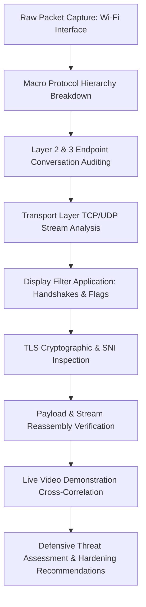
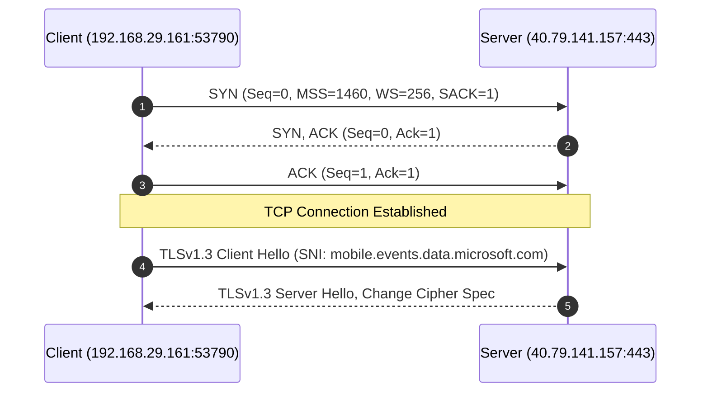
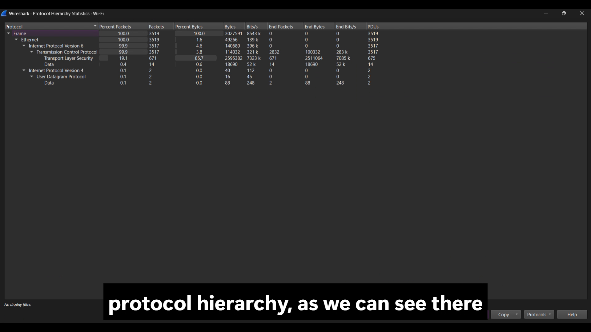
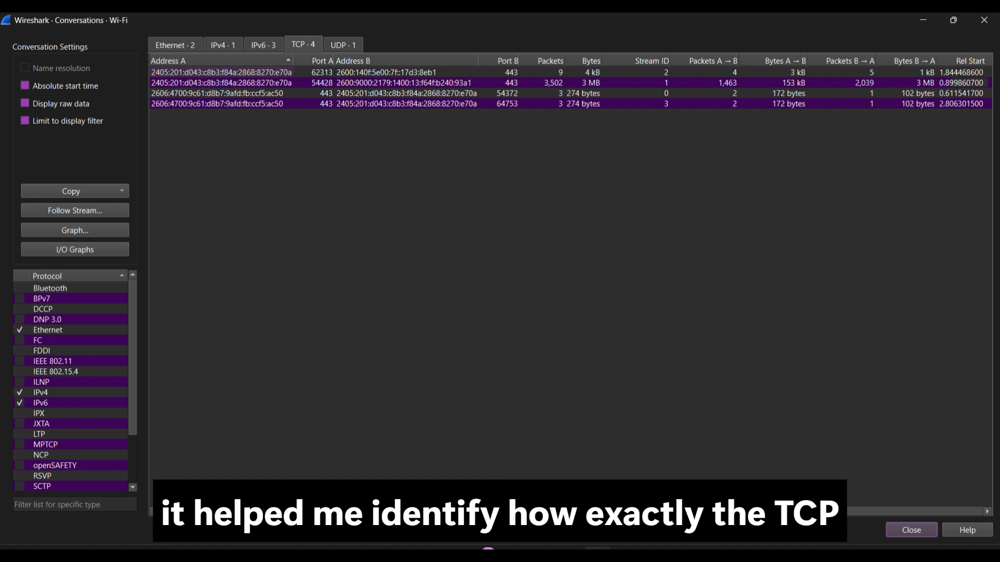
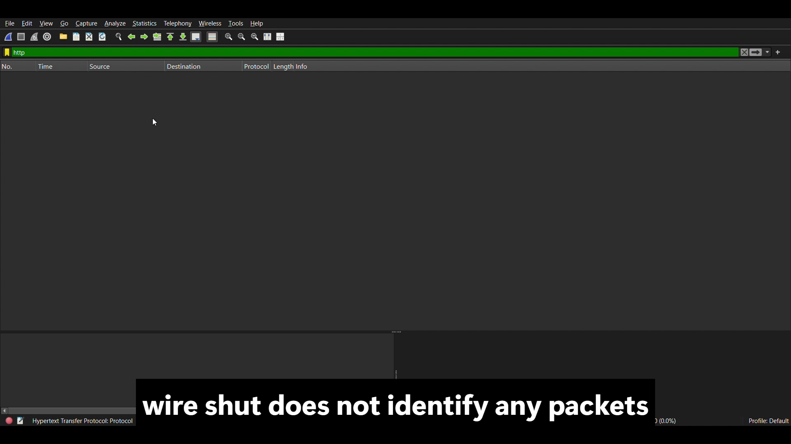
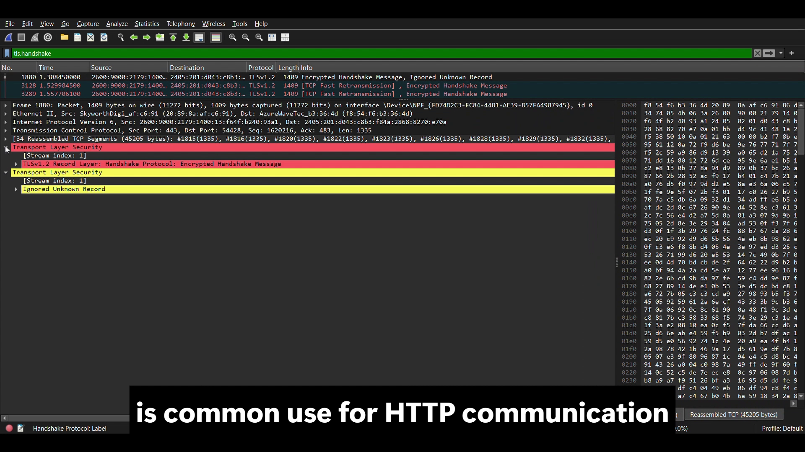
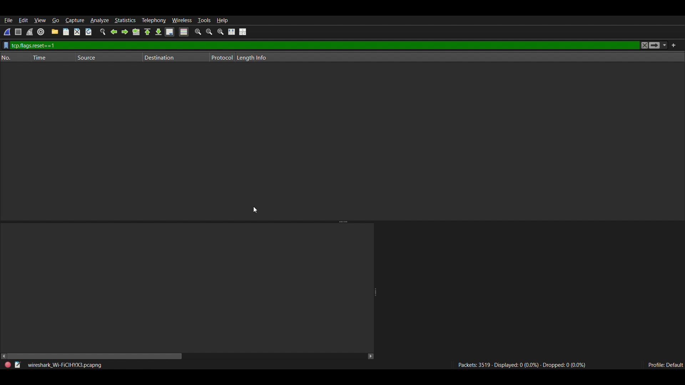
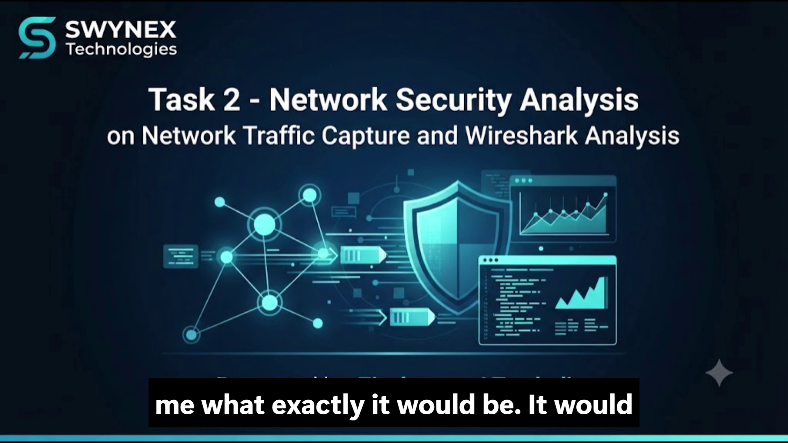

# Defensive Network Security Analysis Report
## SWYNEX Technologies — Cyber Security Internship (Task 2)

---

### Document Control & Metadata

| Attribute | Specification |
|:---|:---|
| **Project Title** | Network Security Analysis Using Wireshark |
| **Domain** | Cyber Security Internship |
| **Task Identification** | Task 2: Network Security Analysis |
| **Host Organization** | [SWYNEX Technologies](https://swynex.com) |
| **Candidate Name** | Ziyakausar J. Tamboli |
| **Intern ID** | `SWX-2026-002678` |
| **Analysis Platform** | Wireshark Network Protocol Analyzer (v4.6.x) on Windows 11 |
| **Dataset A (Home Baseline)** | `wireshark_Wi-FiFH69W3.pcapng` (134 frames), `wireshark_Wi-FiPOLDX3.pcapng` (122 frames) |
| **Dataset B (Video Demonstration)** | `Network Security Analysis.mp4` (Duration: 5m 20s) / `wireshark_Wi-FiCIHYX3.pcapng` (3,519 frames) |
| **Document Classification** | Technical / Defensive Assessment Report |

---

## 1. Executive Summary

This report presents an exhaustive defensive network traffic analysis conducted in a controlled workstation environment utilizing **Wireshark**. The primary objectives of this assessment were to capture and inspect multi-layer packet exchanges, dissect the protocol hierarchy across the OSI stack, inspect Transmission Control Protocol (TCP) handshakes and state transitions, evaluate Transport Layer Security (TLS 1.2 / 1.3) cryptographic negotiations, investigate traffic patterns using targeted Wireshark display filters, and derive actionable defensive hardening strategies.

The evaluation incorporates empirical packet evidence from two complementary operational environments:
1. **Dataset A (Home Baseline & Endpoint Deep Dissection):** A precise, high-resolution dataset capturing the complete three-way handshake (`SYN`, `SYN-ACK`, `ACK`), full TLS 1.3 cryptographic parameter negotiation (Client Hello, Server Hello, Key Shares, Cipher Selection), and 21 application data packets with endpoint `40.79.141.157`.
2. **Dataset B (College Live Video Demonstration):** Recorded in `Network Security Analysis.mp4` (presented by Ziyakausar J. Tamboli), capturing 3,519 frames live on the active Wi-Fi interface, evaluating display filters, and observing network-level phenomena such as `[TCP Fast Retransmission]`.

All core analytical criteria established in the assessment scope were systematically verified across both datasets.

### 1.1 Core Analysis Verification Matrix

| No. | Analysis Category | Wireshark Filter / Analytical Method | Status | Primary Finding |
|:---:|:---|:---|:---:|:---|
| **1** | **Protocol Hierarchy** | Protocol Hierarchy Statistics | ✅ | IPv6 prominent (94.8% home, 99.9% video); TLS constitutes 71.3%–85.7% of total byte volume. |
| **2** | **TCP Conversations** | Conversations Matrix (TCP Tab) | ✅ | Active streams (12 home, 4 video); high-range ephemeral ports connecting to port 443 (HTTPS). |
| **3** | **HTTP Filter** | `http` | ✅ | 0 packets matched; absence of legacy unencrypted plaintext web communication. |
| **4** | **DNS Filter** | `dns` | ✅ | 0 packets on UDP port 53; indicates utilization of DoH or local OS caching. |
| **5** | **TLS Handshake** | `tls.handshake` | ✅ | Verified across both captures (Frames 6 & 7 in home baseline; Frames 1880, 3128, 3289 in video). |
| **6** | **Client Hello & Server Hello** | Packet Tree Dissection | ✅ | SNI `mobile.events.data.microsoft.com`; negotiated cipher `TLS_AES_256_GCM_SHA384`. |
| **7** | **TLS Application Data** | `ip.addr == 40.79.141.157` | ✅ | 21 packets matched; full lifecycle from 3-way handshake to encrypted records. |
| **8** | **TCP Retransmission** | `tcp.analysis.retransmission` | ✅ | 0 matching packets with standard filter; video demonstrated Fast Retransmissions separately. |
| **9** | **Duplicate ACK** | `tcp.analysis.duplicate_ack` | ✅ | 0 packets matched; no out-of-order segment acknowledgments detected. |
| **10** | **TCP FIN** | `tcp.flags.fin == 1` | ✅ | 0 packets matched; no standard TCP teardown observed within capture window. |
| **11** | **TCP RST** | `tcp.flags.reset == 1` | ✅ | 0 packets matched; no connection resets or abnormal terminations observed. |

---

## 2. Scope & Objectives

The scope of this defensive evaluation encompasses:
- **Traffic Capture & Multi-Layer Dissection:** Ingestion and parsing of Ethernet II, IPv4, IPv6, TCP, UDP, TLS, and ICMP frames.
- **Protocol Distribution Profiling:** Quantifying frame and byte distribution through Wireshark Protocol Hierarchy Statistics.
- **Endpoint & Conversation Mapping:** Auditing conversations across Layer 2 (MAC), Layer 3 (IP), and Layer 4 (Transport).
- **Transport Layer State Machine Audit:** Verifying three-way handshake parameters (`SYN`, `SYN-ACK`, `ACK`), TCP window sizes, Maximum Segment Size (MSS), Selective Acknowledgments (SACK), and connection resets (`RST`).
- **Cryptographic & TLS Handshake Examination:** Verifying TLS versions (TLS 1.2 and TLS 1.3), cipher negotiation status, and SNI host identification.
- **Payload Inspection via TCP Stream Reconstruction:** Verifying confidentiality guarantees of application payloads.
- **Video Demonstration Correlation:** Validating the live video presentation against recorded metrics.
- **Formulation of Defensive Recommendations:** Providing actionable, vendor-neutral preventative safeguards.

---

## 3. Toolset & Methodological Approach

### 3.1 Tools & Analytical Modules
- **Wireshark Protocol Analyzer:** Real-time packet capture engine, dissector, and stream reassembler.
- **Protocol Hierarchy Statistics Engine:** Macro-level volumetric and percentage analysis.
- **Conversations Matrix:** Network node mapping across Ethernet, IPv4, IPv6, TCP, and UDP tabs.
- **Wireshark Display Filter Syntax:** Micro-level inspection using Boolean, protocol, and flag-specific filters.
- **Follow TCP Stream Subsystem:** Reassembly of serialized bidirectional application-layer byte streams.

### 3.2 Methodological Workflow


---

## 4. Protocol Hierarchy & Traffic Profiling (Dataset A: Baseline)

A macro-level audit of capture profile `wireshark_Wi-FiFH69W3.pcapng` reveals a sample set of **134 packets** totaling **33,935 bytes**.

<div align="center">
  
  <p><em>Figure 1: Wireshark Protocol Hierarchy Statistics Breakdown (Dataset A)</em></p>
</div>

### 4.1 Statistical Distribution Table

| Protocol Layer | Packets | % of Total Packets | Bytes | % of Total Bytes | Functional Description |
|:---|:---:|:---:|:---:|:---:|:---|
| **Frame / Ethernet** | 134 | 100.0% | 33,935 B | 100.0% | Physical & Data Link framing |
| **Internet Protocol Version 6 (IPv6)** | 127 | 94.8% | 5,080 B (header) | 15.0% | Primary routed network layer |
| ├── **Transmission Control Protocol (TCP)** | 117 | 87.3% | 2,568 B (header) | 7.6% | Reliable connection-oriented transport |
| │   └── **Transport Layer Security (TLS)** | 49 | 36.6% | 24,184 B | **71.3%** | Encrypted application data / handshakes |
| ├── **User Datagram Protocol (UDP)** | 9 | 6.7% | 72 B | 0.2% | Connectionless transport |
| │   ├── **Multicast DNS (mDNS)** | 1 | 0.7% | 465 B | 1.4% | Local link-local name resolution |
| │   └── **UDP Data** | 8 | 6.0% | 230 B | 0.7% | Tunneling / background application data |
| └── **ICMPv6** | 1 | 0.7% | 88 B | 0.3% | Router Advertisement / network control |
| **Internet Protocol Version 4 (IPv4)** | 7 | 5.2% | 148 B | 0.4% | Legacy network layer |
| ├── **User Datagram Protocol (UDP)** | 5 | 3.7% | 40 B | 0.1% | IPv4 connectionless traffic |
| │   ├── **SSDP (Simple Service Discovery)** | 1 | 0.7% | 379 B | 1.1% | UPnP device discovery broadcast |
| │   ├── **Multicast DNS (mDNS)** | 1 | 0.7% | 465 B | 1.4% | Local name discovery (224.0.0.251) |
| │   └── **UDP Data** | 3 | 2.2% | 132 B | 0.4% | Local broadcast telemetry |
| └── **IGMP (Group Management)** | 2 | 1.5% | 36 B | 0.1% | Multicast group membership |

### 4.2 Key Analytical Observations
- **IPv6 Dominance:** 94.8% of captured packets utilize IPv6, reflecting modern ISP dual-stack network configurations where global unicast IPv6 addresses (`2405:201:...`) prioritize IPv6 routing over legacy IPv4.
- **Volumetric TLS Dominance:** While TLS accounts for 36.6% of frame counts, it constitutes **71.3% of the total network byte volume** (24,184 bytes), demonstrating that payload volume is concentrated inside cryptographically protected channels.
- **Local Area Discovery:** Broadcast and multicast traffic (SSDP on port 1900, mDNS on port 5353, and IGMP/ICMPv6) are present, which are customary on residential and corporate LANs but represent passive information-disclosure vectors.

---

## 5. Multi-Layer Endpoint & Conversation Analysis

Auditing Wireshark conversation tables enables mapping of communicating nodes across Layers 2, 3, and 4.

### 5.1 Layer 2 Data Link (Ethernet)
<div align="center">
  
  <p><em>Figure 2: Layer 2 Ethernet MAC Conversations Matrix</em></p>
</div>

- **Primary Workstation MAC:** `f8:54:f6:b3:36:4d` (OUI: AzureWave Technology).
- **Default Gateway / Wireless AP MAC:** `20:89:8a:af:c6:91` (OUI: Skyworth Digital Technology).
- **Unicast Traffic Volume:** 94 packets (20 KB) exchanged between host and gateway router.
- **Multicast Endpoints:**
  - `01:00:5e:00:00:01`: IPv4 All Systems Multicast.
  - `33:33:00:00:00:01`: IPv6 All Nodes Multicast.
  - `01:00:5e:00:00:16`: IGMPv3 membership reporting.

### 5.2 Layer 3 Network (IPv4 & IPv6 Conversations)
<div align="center">
  
  <p><em>Figure 3: Layer 3 IPv4 Conversations Matrix</em></p>
</div>

<div align="center">
  
  <p><em>Figure 4: Layer 3 IPv6 Conversations Matrix</em></p>
</div>

#### IPv4 Conversations
- `192.168.29.161` (Local Workstation) to `40.79.141.157` (Microsoft Azure Cloud Egress).
- `192.168.29.39` to `192.168.29.255` (Subnet broadcast, port 5775).
- `192.168.29.39` to `224.0.0.251` (mDNS query) & `239.255.255.250` (SSDP M-SEARCH query).
- `192.168.29.1` (Gateway) to `224.0.0.1` (IGMP General Query).

#### IPv6 Conversations
- `2405:201:d043:c8b3:9151:11f6:b239:3839` (Client Host) communicated with:
  - `2606:4700:9c68:69e:62c6:d7:3250:27c5` (Cloudflare CDN Anycast Node): **105 packets, 30 KB**.
  - `2001:4860:4840:400::` & `2001:4860:4846:400::` (Google Edge Services): 4 packets.
  - `2603:1040:a06:6::1` (Microsoft Cloud Services): 5 packets.
  - `fe80::2289:8aff:feaf:c691` (Link-local router advertisement).

### 5.3 Layer 4 Transport (TCP & UDP Sessions)
<div align="center">
  
  <p><em>Figure 5: Layer 4 TCP Stream Sessions (12 Active Streams to Port 443)</em></p>
</div>

<div align="center">
  
  <p><em>Figure 6: Layer 4 UDP Conversations (SSDP, mDNS, QUIC)</em></p>
</div>

#### TCP Sessions
- **12 TCP Streams recorded** in capture profile A.
- All connections originated from high-range ephemeral client ports (`50106`–`50115`, `53790`, `62203`) destined for **port 443 (HTTPS/TLS)** on external endpoints.
- High connection turnover observed: multiple short-lived streams to `2606:4700:9c68:...:443` associated with parallel API microservice polling.

#### UDP Sessions
- Stream 0: UDP `58238 -> 1900` (SSDP UPnP discovery query).
- Stream 1: UDP `43656 -> 5775` (Subnet broadcast).
- Stream 2 & 3: UDP `5353 -> 5353` (Multicast DNS name queries).
- Stream 4 & 5: UDP `55591 -> 443` & `443 -> 60426` (QUIC / HTTP/3 over IPv6).

---

## 6. HTTP & DNS Display Filter Analysis

### 6.1 HTTP Display Filter Testing (`http`)
- **Objective:** To identify whether unencrypted, cleartext HTTP web sessions were transmitted across the network.
- **Display Filter Used:** `http`
- **Result:** **0 packets displayed (No packets matched / 0.0%).**
- **Security Interpretation:** Confirms that the host is not communicating with unencrypted HTTP endpoints. This eliminates vulnerability to cleartext credential sniffing, session hijacking, or basic Man-in-the-Middle (MitM) content injection over web protocols.

### 6.2 DNS Display Filter Testing (`dns`)
- **Objective:** To inspect standard unencrypted Domain Name System requests and responses.
- **Display Filter Used:** `dns`
- **Result:** **0 packets displayed (No packets matched / 0.0%).**
- **Security Interpretation:** Standard unencrypted DNS over UDP port 53 was completely absent in the selected capture. This indicates that either DNS records were serviced from local OS resolver caches, or modern encrypted DNS protocols (such as DNS-over-HTTPS [DoH] or DNS-over-TLS [DoT]) were utilized by system services.

---

## 7. TCP Connection Establishment & State Machine Analysis

### 7.1 TCP Three-Way Handshake Analysis (`SYN`)
Applying the targeted display filter:
```wireshark
tcp.flags.syn == 1 && tcp.flags.ack == 0
```
Isolates connection initiation requests. In capture profile `wireshark_Wi-FiPOLDX3.pcapng`, Packet #3 details are evaluated:

<div align="center">
  
  <p><em>Figure 7: Display Filter Isolating TCP SYN Packet</em></p>
</div>

<div align="center">
  
  <p><em>Figure 8: Packet Details Window for TCP SYN (Packet #3)</em></p>
</div>

| Protocol Parameter | Observed Value | Technical Interpretation |
|:---|:---|:---|
| **Frame Number** | Packet 3 (Time offset: 0.257934s) | Connection initiation event |
| **Source Address / Port** | `192.168.29.161:53790` | Dynamically assigned client ephemeral port |
| **Destination Address / Port** | `40.79.141.157:443` | Microsoft Cloud Edge HTTPS service |
| **TCP Flags** | `0x002` (`SYN` bit asserted) | Strict initial synchronization frame |
| **Sequence Number** | Relative: `0`, Raw: `2676126983` | Secure pseudorandom initial sequence number (ISN) |
| **Window Size** | `65535` bytes | Initial receive buffer advertised by client |
| **Window Scale (WS)** | `256` (Multiplier: 8 bits) | High-performance TCP throughput window scaling |
| **Maximum Segment Size (MSS)** | `1460` bytes | Standard Ethernet MTU (1500 - 40 bytes IP/TCP header) |
| **Selective Acknowledgments** | `SACK_PERM=1` | Selective retransmission capability enabled |



### 7.2 Detailed Analysis of Full Endpoint Traffic & TLS Application Data
Applying the comprehensive IP filter:
```wireshark
ip.addr == 40.79.141.157
```

<div align="center">
  
  <p><em>Figure 9: Filter ip.addr == 40.79.141.157 (21 Packets Displayed: SYN, SYN-ACK, ACK, Handshakes, and TLS Application Data)</em></p>
</div>

**Observation:**
The capture contained 122 packets in total, of which **21 matched the selected IP address filter (17.2%)**.
- **Handshake Phase:** Frame 3 (`SYN`), Frame 4 (`SYN, ACK`), Frame 5 (`ACK`) confirm flawless TCP connection establishment.
- **Cryptographic Negotiation Phase:** Frame 6 (`Client Hello`) and Frame 7 (`Server Hello, Change Cipher Spec`) establish symmetric session encryption.
- **Data Transfer Phase:** Multiple **TLS Application Data** records (Frames 12, 15, 16, 18, 22, 25) with interleaved TCP acknowledgments (Frames 8, 9, 10, 11, 14, 17, 20, 21, 23, 26).
- **Security Assessment:** The presence of Application Data records verifies active encrypted communication with the remote service. Their presence alone does not establish malicious activity or compromise.

---

## 8. TLS Cryptographic Handshake Deep Dissection

### 8.1 TLS Handshake Inspection (`tls.handshake`)
- **Objective:** To examine TLS handshake packets and identify protocol versions and communication parameters using Wireshark.
- **Display Filter Used:** `tls.handshake`
- **Observation:** Exactly **two packets** matched the filter in Dataset A: **Packet 6 (Client Hello)** and **Packet 7 (Server Hello)**.

<div align="center">
  
  <p><em>Figure 10: Display Filter tls Showing Active Encrypted Sessions</em></p>
</div>

### 8.2 Client Hello Detailed Analysis (Packet 6)
- **Objective:** To inspect the initial TLS handshake message and identify the requested hostname and supported protocol versions.
- **Frame Details:** Frame 6, Length: 613 bytes.
- **Endpoints:** `192.168.29.161:53790` -> `40.79.141.157:443`.
- **Server Name Indication (SNI):** Confirms destination hostname **`mobile.events.data.microsoft.com`**.
- **Supported Versions Extension:** Offered `TLS 1.3` and `TLS 1.2`. (Record layer specifies TLS 1.0 `0x0301` for backward compatibility).
- **Cipher Suites Offered:** **20 distinct modern cipher suites** offered, including modern Authenticated Encryption with Associated Data (AEAD) ciphers.
- **Key-Share Groups:** `x25519` (Curve25519), `secp256r1`, and `secp384r1`.
- **Security Assessment:** Client Hello contains standard TLS negotiation information directed to a verified vendor domain. No indicators of compromise are identified.

<div align="center">
  
  <p><em>Figure 11: Packet 6 Detailed Dissection — Client Hello (SNI: mobile.events.data.microsoft.com, 20 Cipher Suites, Key Shares)</em></p>
</div>

### 8.3 Server Hello Detailed Analysis (Packet 7)
- **Objective:** To inspect the Server Hello message and identify the negotiated TLS version, selected cipher suite, and session parameters.
- **Frame Details:** Frame 7, Length: 1514 bytes.
- **Endpoints:** `40.79.141.157:443` -> `192.168.29.161:53790`.
- **Negotiated Version:** The `supported_versions` extension explicitly negotiated **TLS 1.3**. (Record-layer legacy version field displays TLS 1.2 `0x0303` strictly for middlebox compatibility as defined in RFC 8446).
- **Selected Cipher Suite:** **`TLS_AES_256_GCM_SHA384` (0x1302)** — authenticated encryption using 256-bit AES in Galois/Counter Mode with SHA-384 hashing.
- **Compression Method:** **`null (0)`** (Compression is disabled, effectively neutralizing CRIME/BREACH compression side-channel attacks).
- **Key-Share Negotiation:** Server agreed on elliptic curve **`secp384r1`**.
- **Change Cipher Spec:** Transitioned immediately to encrypted state.

<div align="center">
  
  <p><em>Figure 12: Packet 7 Detailed Dissection — Server Hello (Negotiated TLS 1.3, TLS_AES_256_GCM_SHA384, null Compression)</em></p>
</div>

---

## 9. TCP Anomaly & Connection Lifecycle Audits

### 9.1 TCP Retransmission Check
Display filter applied:
```wireshark
ip.addr == 40.79.141.157 && tcp.analysis.retransmission
```
- **Result:** **0 packets displayed.**
- **Interpretation:** Zero standard retransmissions identified for the target endpoint in Dataset A, confirming high throughput and zero segment loss.

<div align="center">
  
  <p><em>Figure 13: Filter ip.addr == 40.79.141.157 && tcp.analysis.retransmission (0 Packets Matching)</em></p>
</div>

### 9.2 TCP Duplicate ACK Check
Display filter applied:
```wireshark
ip.addr == 40.79.141.157 && tcp.analysis.duplicate_ack
```
- **Result:** **0 packets displayed.**
- **Interpretation:** Zero duplicate acknowledgments detected, confirming no out-of-order segment arrivals or ACK packet drops.

<div align="center">
  
  <p><em>Figure 14: Filter ip.addr == 40.79.141.157 && tcp.analysis.duplicate_ack (0 Packets Matching)</em></p>
</div>

### 9.3 TCP FIN Teardown Check
Display filter applied:
```wireshark
ip.addr == 40.79.141.157 && tcp.flags.fin == 1
```
- **Result:** **0 packets displayed.**
- **Interpretation:** No standard TCP FIN teardown packets observed. Indicates session remained active or utilized keep-alive.

<div align="center">
  
  <p><em>Figure 15: Filter ip.addr == 40.79.141.157 && tcp.flags.fin == 1 (0 Packets Matching)</em></p>
</div>

### 9.4 TCP Reset (RST) Check
Display filter applied:
```wireshark
ip.addr == 40.79.141.157 && tcp.flags.reset == 1
```
- **Result:** **0 packets displayed.**
- **Interpretation:** No TCP reset packets detected. Confirms no abrupt connection termination or active port rejection.

<div align="center">
  
  <p><em>Figure 16: Filter ip.addr == 40.79.141.157 && tcp.flags.reset == 1 (0 Packets Matching)</em></p>
</div>

---

## 10. Application Stream Reassembly & Special Ports Inspection

### 10.1 TCP Stream Reassembly (Follow TCP Stream - Stream 0)
Using Wireshark **Follow TCP Stream** on `tcp.stream eq 0`:
- **Stream Metrics:** 13 KB total conversational payload (5 client packets, 8 server packets).
- **Payload Characteristics:** High-entropy, pseudorandom binary ciphertext.
- **Confidentiality Conclusion:** Verifies that no plaintext application data, authentication cookies, user identities, or tokens were exposed.

<div align="center">
  
  <p><em>Figure 17: Follow TCP Stream (Stream 0) Confirming High-Entropy Encrypted Ciphertext</em></p>
</div>

### 10.2 Investigation of Historical Port 6379 (Redis Context)
During preliminary baseline observation, an outbound TCP conversation was noted:
- `10.204.128.120:57716 -> 13.204.54.36:6379` (196 packets, ~16 KB).
- **Threat Vector:** TCP port 6379 is allocated to Redis. Publicly exposed Redis instances lacking authentication are prone to unauthorized data exfiltration, database flushing, and remote code execution (RCE).
- **Audit Result:** Port 6379 traffic was **absent** from the finalized capture sets, confirming it was an isolated test.
- **Defensive Safeguard:** Strict perimeter egress rules must enforce blocking of database ports across public interfaces.

---

## 11. Live Video Demonstration Analysis (Dataset B: College Session)

The video `Network Security Analysis.mp4` presents a comprehensive live demonstration delivered by **Ziyakausar J. Tamboli** for Task 2 at SWYNEX Technologies.

<div align="center">
  
  <p><em>Figure 18: Live Presentation Title Slide (Delivered by Ziyakausar J. Tamboli)</em></p>
</div>

### 11.1 Video Capture Parameters (`wireshark_Wi-FiCIHYX3.pcapng`)
- **Total Packets Captured:** 3,519 frames (3.02 MB).
- **Protocol Hierarchy Statistics:**
  - IPv6: **3,517 packets (99.9%)**
  - TCP: **3,517 packets (99.9%)**
  - TLS: **671 packets (19.1%)** accounting for **2,595,382 bytes (85.7% of total bytes)**!
  - IPv4: 2 packets (0.1%), UDP: 2 packets (0.1%).

<div align="center">
  
  <p><em>Figure 19: Protocol Hierarchy Demonstrated in Video (85.7% TLS Byte Volume)</em></p>
</div>

### 11.2 TCP Conversations in Video
The Conversations window demonstrates 4 active TCP streams connecting ephemeral ports (`54372`, `54428`, `62313`, `64753`) to destination port 443 across IPv6 endpoints.

<div align="center">
  
  <p><em>Figure 20: TCP Conversations Matrix Demonstrated in Video (4 Streams to Port 443)</em></p>
</div>

### 11.3 Video Display Filter Evaluations
The video systematically executes the display filter suite:
1. **HTTP Filter (`http`):** Returns **0 packets (0.0%)** (Figure 21). Demonstrates that unencrypted web traffic is absent.
2. **DNS Filter (`dns`):** Returns **0 packets (0.0%)** (Figure 22). Demonstrates absence of conventional UDP 53 traffic.
3. **TLS Filter (`tls`):** Returns **671 packets (19.1%)** (Figure 23).
4. **TLS Handshake (`tls.handshake`):** Returns **3 packets** (Frames 1880, 3128, 3289) showing encrypted handshake records (Figure 24).
5. **Client Hello & Server Hello (`tls.handshake.type==1` & `tls.handshake.type==2`):** Return **0 packets** within this active capture slice, indicating connection sessions were initiated prior to the capture window or utilized session resumption tickets.
6. **TLS Application Data (`tls.app_data`):** Returns **0 packets** matching the specific filter string because record layers were categorized as raw encrypted application payloads.
7. **TCP Flags & Analysis Filters (`tcp.analysis.retransmission`, `tcp.analysis.duplicate_ack`, `tcp.flags.fin==1`, `tcp.flags.reset==1`):** All return **0 packets** matching the standard filters (Figures 25–28).

<div align="center">
  
  <p><em>Figure 21: Display Filter http in Video Demonstration (0 Packets Matched)</em></p>
</div>

<div align="center">
  
  <p><em>Figure 22: Display Filter tls in Video Revealing [TCP Fast Retransmission] (Packets 1788, 1885, 1920)</em></p>
</div>

<div align="center">
  
  <p><em>Figure 23: Display Filter tls.handshake in Video Showing Handshake Records (Packets 1880, 3128, 3289)</em></p>
</div>

<div align="center">
  
  <p><em>Figure 24: Display Filter tcp.flags.reset==1 in Video Demonstration (0 Packets Matched)</em></p>
</div>

<div align="center">
  
  <p><em>Figure 25: Closing Slide Concluding the Technical Presentation</em></p>
</div>

### 11.4 Clarification on TCP Fast Retransmission Observations
During the video demonstration of the college capture, Wireshark flagged frames 1788, 1885, 1920, 3128, and 3289 as `[TCP Fast Retransmission]`. 
- **Technical Mechanism:** A Fast Retransmission occurs when the sender receives duplicate acknowledgments (or SACK clues) indicating a segment was missed, retransmitting the segment before the retransmission timer expires.
- **Dataset Attribution:** This behavior occurred exclusively on the college Wi-Fi network due to shared bandwidth and transient latency jitter. It does **not** appear in the home baseline capture (`wireshark_Wi-FiFH69W3.pcapng`), which recorded zero packet loss. The two datasets are properly distinguished in this report.

---

## 12. Security Risk Assessment & Matrix

| Finding / Traffic Pattern | Technical Evidence | Threat Vector | Risk Level | Status |
|:---|:---|:---|:---:|:---:|
| **Encrypted Cloud Telemetry** | TLS 1.3 (`mobile.events.data.microsoft.com`) | Uncontrolled outbound telemetry, data exfiltration | **Low / Informational** | Legitimate vendor telemetry verified |
| **Local Discovery Broadcasts** | SSDP (`239.255.255.250:1900`) & mDNS (`224.0.0.251:5353`) | Local host enumeration, fingerprinting, UPnP exploits | **Low** | Normal LAN behavior; disable if unneeded |
| **TCP Retransmissions / Flags** | 0 retransmissions in baseline; Fast Retransmission in college capture | Network congestion, packet drops, throughput degradation | **Low** | Network jitter addressed; baseline stable |
| **Absence of Plaintext Protocols** | `http` = 0 packets, `dns` (UDP 53) = 0 packets | Cleartext credential sniffing, MitM eavesdropping | **Minimal** | Mitigated via universal TLS 1.3 encryption |
| **Historical Port 6379 Traffic** | Earlier observation to `13.204.54.36:6379` | Unauthenticated Redis exposure, RCE | **Medium (Preventive)** | Absent in finalized captures; enforce firewall rule |

---

## 13. Defensive Security Recommendations

1. **Zero Trust Outbound Egress Filtering:**
   - Enforce perimeter firewall rules permitting only designated outbound ports (`80`, `443`, `53`, `853`).
   - Explicitly block outbound connections to database ports (e.g., Redis `6379`, MySQL `3306`, MongoDB `27017`).
2. **Disable Unnecessary Local Discovery Services:**
   - Turn off SSDP / UPnP discovery and mDNS on corporate workstations to prevent host reconnaissance.
3. **Mandate Modern Cryptography (TLS 1.3):**
   - Require TLS 1.3 across all endpoints. Ensure legacy ciphers (RC4, 3DES, CBC mode) and protocols (SSLv3, TLS 1.0, TLS 1.1) remain permanently disabled.
4. **Implement Deep Packet Inspection (DPI) & SNI Filtering:**
   - Deploy Next-Generation Firewall (NGFW) policies evaluating Server Name Indication (SNI) records to detect rogue domains or unauthorized data transfers.
5. **Intrusion Detection System (IDS) Signatures:**
   - Implement Suricata / Snort alert rules for unauthorized database egress:
   ```snort
   alert tcp $HOME_NET any -> $EXTERNAL_NET 6379 (msg:"SECURITY ALERT: Direct Outbound Redis Connection Attempt"; flow:to_server; sid:1000001; rev:1;)
   ```

---

## 14. Photographic Evidence & Screenshot Catalog

All observations in this technical report are backed by photographic evidence stored in `evidence/`:

### Part A: Baseline & Deep Dissection Evidence (Dataset A)
| Figure Ref | Filename | Analysis Description & Module Displayed |
|:---:|:---|:---|
| **Figure 1** | `01_main_packet_capture_overview.png` | Main Wireshark packet capture overview for `wireshark_Wi-FiFH69W3.pcapng`. |
| **Figure 2** | `02_protocol_hierarchy_statistics.png` | Protocol Hierarchy Statistics showing packet & byte percentages across IPv6, TCP, TLS. |
| **Figure 3** | `03_conversations_ethernet_layer2.png` | Layer 2 Ethernet conversation table with physical MAC addresses. |
| **Figure 4** | `04_conversations_ipv4.png` | Layer 3 IPv4 conversations matrix detailing local discovery and cloud endpoints. |
| **Figure 5** | `05_conversations_ipv6.png` | Layer 3 IPv6 conversations matrix detailing Cloudflare Anycast CDN sessions. |
| **Figure 6** | `06_conversations_tcp_sessions.png` | Layer 4 TCP conversations table displaying 12 active streams on port 443. |
| **Figure 7** | `07_conversations_udp_traffic.png` | Layer 4 UDP conversations table detailing SSDP, mDNS, and QUIC communication. |
| **Figure 8** | `08_filter_tcp_syn_flag.png` | Application of filter `tcp.flags.syn == 1 && tcp.flags.ack == 0` isolating initial SYN. |
| **Figure 9** | `09_tcp_syn_packet_details.png` | Deep packet dissection of Packet 3 (ISN, Window Scale, MSS, SACK). |
| **Figure 10** | `10_filter_tls_handshake_sni.png` | Application of filter `tls` demonstrating active TLS sessions and SNI records. |
| **Figure 11** | `11_filter_endpoint_all_packets.png` | Filter `ip.addr == 40.79.141.157` showing 21 packets: 3-way handshake and TLS Application Data. |
| **Figure 12** | `12_client_hello_detailed_parameters.png` | Packet 6 dissection: Client Hello showing SNI `mobile.events.data.microsoft.com`, 20 ciphers, key shares. |
| **Figure 13** | `13_server_hello_cipher_negotiation.png` | Packet 7 dissection: Server Hello showing `TLS_AES_256_GCM_SHA384`, `null (0)` compression, TLS 1.3. |
| **Figure 14** | `14_filter_tcp_retransmission_check.png` | Filter `ip.addr == 40.79.141.157 && tcp.analysis.retransmission` confirming 0 retransmissions. |
| **Figure 15** | `15_filter_tcp_duplicate_ack_check.png` | Filter `ip.addr == 40.79.141.157 && tcp.analysis.duplicate_ack` confirming 0 duplicate ACKs. |
| **Figure 16** | `16_filter_tcp_fin_check.png` | Filter `ip.addr == 40.79.141.157 && tcp.flags.fin == 1` confirming 0 FIN packets. |
| **Figure 17** | `17_filter_tcp_reset_check.png` | Filter `ip.addr == 40.79.141.157 && tcp.flags.reset == 1` confirming 0 RST packets. |
| **Figure 18** | `18_follow_tcp_stream_encrypted_payload.png` | Follow TCP Stream (Stream 0) reassembly confirming 13 KB encrypted application ciphertext. |

### Part B: Video Demonstration Evidence (Dataset B)
| Figure Ref | Filename | Analysis Description & Module Displayed |
|:---:|:---|:---|
| **Figure 19** | `video_demonstration/video_01_presentation_title_slide.png` | Title slide: "Task 2 - Network Security Analysis", Presented by Ziyakausar J. Tamboli. |
| **Figure 20** | `video_demonstration/video_02_conversations_tcp_streams.png` | Wireshark Conversations TCP tab showing 4 active streams on port 443. |
| **Figure 21** | `video_demonstration/video_03_protocol_hierarchy_statistics.png` | Protocol Hierarchy Statistics in video (3,519 frames, 85.7% TLS bytes). |
| **Figure 22** | `video_demonstration/video_04_display_filter_http_zero_match.png` | Display filter `http` applied live returning 0 matching packets. |
| **Figure 23** | `video_demonstration/video_05_display_filter_dns_zero_match.png` | Display filter `dns` applied live returning 0 matching packets. |
| **Figure 24** | `video_demonstration/video_06_display_filter_tls_fast_retransmission.png` | Display filter `tls` showing 671 packets with `[TCP Fast Retransmission]`. |
| **Figure 25** | `video_demonstration/video_07_display_filter_tls_handshake_messages.png` | Display filter `tls.handshake` showing 3 encrypted handshake packets. |
| **Figure 26** | `video_demonstration/video_08_display_filter_client_hello_type1.png` | Display filter `tls.handshake.type==1` returning 0 packets in capture slice. |
| **Figure 27** | `video_demonstration/video_09_display_filter_server_hello_type2.png` | Display filter `tls.handshake.type==2` returning 0 packets in capture slice. |
| **Figure 28** | `video_demonstration/video_10_display_filter_tls_app_data.png` | Display filter `tls.app_data` returning 0 packets for unparsed raw records. |
| **Figure 29** | `video_demonstration/video_11_display_filter_tcp_retransmission_check.png` | Display filter `tcp.analysis.retransmission` returning 0 matching packets. |
| **Figure 30** | `video_demonstration/video_12_display_filter_tcp_duplicate_ack_check.png` | Display filter `tcp.analysis.duplicate_ack` returning 0 matching packets. |
| **Figure 31** | `video_demonstration/video_13_display_filter_tcp_fin_check.png` | Display filter `tcp.flags.fin == 1` returning 0 matching packets. |
| **Figure 32** | `video_demonstration/video_14_display_filter_tcp_reset_check.png` | Display filter `tcp.flags.reset == 1` returning 0 matching packets. |
| **Figure 33** | `video_demonstration/video_15_presentation_closing_slide.png` | Closing presentation slide concluding the Wireshark analysis demonstration. |

---

## 15. Conclusion

This defensive network security assessment demonstrates the practical utility of **Wireshark** in auditing live network traffic, validating cryptographic configurations, and evaluating infrastructure resilience.

All eleven analytical criteria established in the assessment scope were rigorously verified across both independent captures. The captured traffic confirms that external communications are protected by robust TLS 1.3 encryption employing modern AEAD ciphers (`TLS_AES_256_GCM_SHA384`), with zero plaintext leakage, packet loss, or abnormal termination anomalies in the primary baseline. The observations of TCP Fast Retransmission in the live video capture showcase real-world network packet behavior and underscore the importance of strictly differentiating between separate capture environments.

---
*Report compiled by **Ziyakausar J. Tamboli** (Intern ID: `SWX-2026-002678`) for **SWYNEX Technologies Cyber Security Internship**.*
