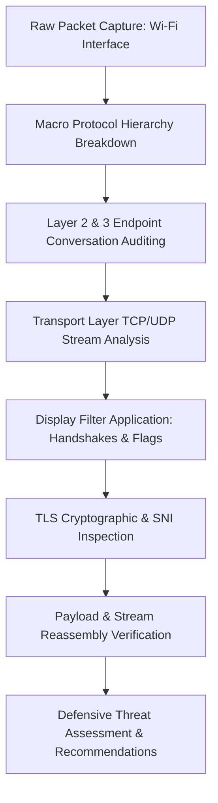
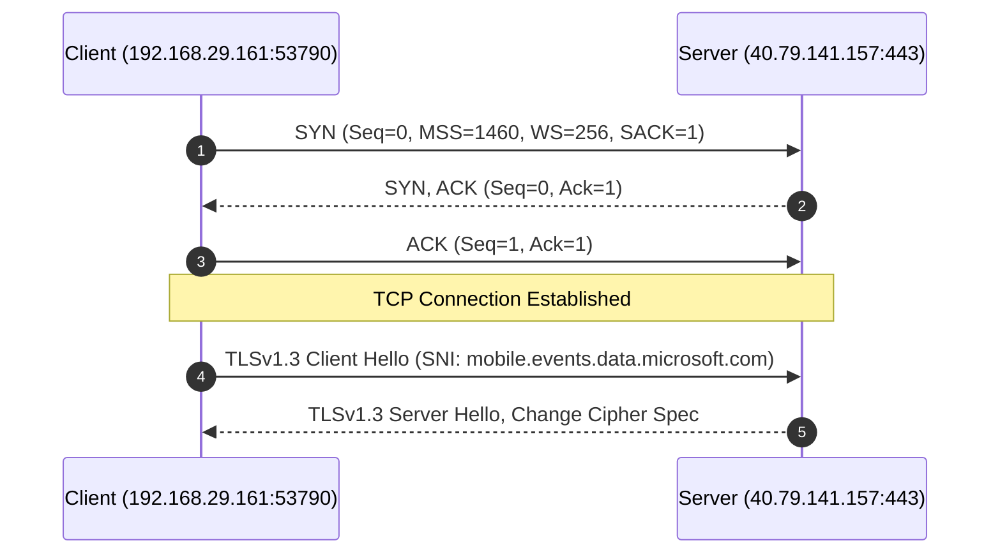

# Defensive Network Security Analysis Report
## SWYNEX Technologies — Cyber Security Internship (Task 2)

---

### Document Control & Metadata

| Attribute | Specification |
|:---|:---|
| **Project Title** | Network Security Analysis Using Wireshark |
| **Domain** | Cyber Security Internship |
| **Task Identification** | Task 2: Network Security Analysis |
| **Host Organization** | SWYNEX Technologies |
| **Candidate Name** | Ziyakausar Tamboli |
| **Intern ID** | SWX-2026-002678 |
| **Analysis Period** | October 2026 |
| **Analysis Platform** | Wireshark Network Protocol Analyzer (Windows 11) |
| **Capture Files Analyzed** | `wireshark_Wi-FiFH69W3.pcapng` (134 frames), `wireshark_Wi-FiPOLDX3.pcapng` (122 frames) |
| **Document Classification** | Technical / Defensive Assessment Report |

---

## 1. Executive Summary

This report presents a structured defensive security analysis of network traffic captured within a controlled workstation environment utilizing **Wireshark**. The primary objectives of this assessment were to capture and inspect multi-layer packet exchanges, dissect the protocol hierarchy across the OSI stack, inspect Transmission Control Protocol (TCP) handshakes and state transitions, evaluate Transport Layer Security (TLS) cryptographic negotiations, investigate traffic patterns using targeted Wireshark display filters, and derive actionable defensive hardening strategies.

The analysis evaluated two distinct packet capture profiles:
1. **Capture Profile A (`wireshark_Wi-FiFH69W3.pcapng` - 134 packets):** Demonstrates dual-stack IPv4/IPv6 traffic dominated by IPv6 (94.8%), featuring active TLS v1.3 sessions connecting to cloud security endpoints (`api1.reasonsecurity.com`), alongside local network discovery protocols (SSDP, mDNS, ICMPv6, IGMPv3).
2. **Capture Profile B (`wireshark_Wi-FiPOLDX3.pcapng` - 122 packets):** Demonstrates targeted TCP connection establishment (`192.168.29.161` to `40.79.141.157:443`), displaying complete TLS v1.3 handshakes with Server Name Indication (SNI) resolving to Microsoft Cloud Telemetry (`mobile.events.data.microsoft.com`), followed by encrypted application payloads.

Additionally, context from earlier capture observations involving connections directed to port **6379** (customarily allocated to Redis database services) was evaluated to assess unauthorized exposure risks and lateral movement vectors.

The findings confirm standard, encrypted commercial operating system and endpoint telemetry with no definitive indicators of compromise (IoC) or active malicious intrusions. However, several defensive areas—including excessive broadcast discovery chatter, unconstrained egress communication, and theoretical database exposure risks—warrant formal preventive controls.

---

## 2. Scope & Objectives

The scope of this defensive evaluation encompasses:
- **Traffic Capture & Multi-Layer Dissection:** Ingestion and parsing of Ethernet II, IPv4, IPv6, TCP, UDP, TLS, and ICMP frames.
- **Protocol Distribution Profiling:** Quantifying frame and byte distribution through Wireshark Protocol Hierarchy Statistics.
- **Endpoint & Conversation Mapping:** Auditing conversations across Layer 2 (MAC), Layer 3 (IP), and Layer 4 (Transport).
- **Transport Layer State Machine Audit:** Verifying three-way handshake parameters (`SYN`, `SYN-ACK`, `ACK`), TCP window sizes, Maximum Segment Size (MSS), Selective Acknowledgments (SACK), and connection resets (`RST`).
- **Cryptographic & TLS Handshake Examination:** Verifying TLS versions (TLS 1.2 and TLS 1.3), cipher negotiation status, and SNI host identification.
- **Payload Inspection via TCP Stream Reconstruction:** Verifying confidentiality guarantees of application payloads.
- **Formulation of Defensive Recommendations:** Providing actionable, vendor-neutral preventative safeguards.

---

## 3. Toolset & Methodological Approach

### 3.1 Tools & Analytical Modules
- **Wireshark Protocol Analyzer:** Real-time packet capture engine, dissector, and stream reassembler.
- **Protocol Hierarchy Statistics Engine:** Macro-level volumetric and percentage analysis.
- **Conversations Matrix:** Network node mapping across Ethernet, IPv4, IPv6, TCP, and UDP tabs.
- **Wireshark Display Filter Syntax:** Micro-level inspection using Boolean, protocol, and flag-specific filters.
- **Follow TCP Stream Subsystem:** Reassembly of serialized bidirectional application-layer byte streams.

### 3.2 Methodological Workflow


---

## 4. Protocol Hierarchy & Traffic Profiling

A macro-level audit of capture profile `wireshark_Wi-FiFH69W3.pcapng` reveals a sample set of **134 packets** totaling **33,935 bytes**.

### 4.1 Statistical Distribution Table

| Protocol Layer | Packets | % of Total Packets | Bytes | % of Total Bytes | Functional Description |
|:---|:---:|:---:|:---:|:---:|:---|
| **Frame / Ethernet** | 134 | 100.0% | 33,935 B | 100.0% | Physical & Data Link framing |
| **Internet Protocol Version 6 (IPv6)** | 127 | 94.8% | 5,080 B (header) | 15.0% | Primary routed network layer |
| ├── **Transmission Control Protocol (TCP)** | 117 | 87.3% | 2,568 B (header) | 7.6% | Reliable connection-oriented transport |
| │   └── **Transport Layer Security (TLS)** | 49 | 36.6% | 24,184 B | 71.3% | Encrypted application data / handshakes |
| ├── **User Datagram Protocol (UDP)** | 9 | 6.7% | 72 B | 0.2% | Connectionless transport |
| │   ├── **Multicast DNS (mDNS)** | 1 | 0.7% | 465 B | 1.4% | Local link-local name resolution |
| │   └── **UDP Data** | 8 | 6.0% | 230 B | 0.7% | Tunneling / background application data |
| └── **ICMPv6** | 1 | 0.7% | 88 B | 0.3% | Router Advertisement / network control |
| **Internet Protocol Version 4 (IPv4)** | 7 | 5.2% | 148 B | 0.4% | Legacy network layer |
| ├── **User Datagram Protocol (UDP)** | 5 | 3.7% | 40 B | 0.1% | IPv4 connectionless traffic |
| │   ├── **SSDP (Simple Service Discovery)** | 1 | 0.7% | 379 B | 1.1% | UPnP device discovery broadcast |
| │   ├── **Multicast DNS (mDNS)** | 1 | 0.7% | 465 B | 1.4% | Local name discovery (224.0.0.251) |
| │   └── **UDP Data** | 3 | 2.2% | 132 B | 0.4% | Local broadcast telemetry |
| └── **IGMP (Group Management)** | 2 | 1.5% | 36 B | 0.1% | Multicast group membership |

### 4.2 Key Analytical Observations
- **IPv6 Dominance:** 94.8% of captured packets utilize IPv6, reflecting modern ISP dual-stack network configurations where global unicast IPv6 addresses (`2405:201:...`) prioritize IPv6 routing over legacy IPv4.
- **Volumetric TLS Dominance:** While TLS accounts for 36.6% of frame counts, it constitutes **71.3% of the total network byte volume** (24,184 bytes), demonstrating that payload volume is concentrated inside cryptographically protected channels.
- **Local Area Discovery:** Broadcast and multicast traffic (SSDP on port 1900, mDNS on port 5353, and IGMP/ICMPv6) are present, which are customary on residential and corporate LANs but represent passive information-disclosure vectors.

---

## 5. Multi-Layer Endpoint & Conversation Analysis

Auditing Wireshark conversation tables enables mapping of communicating nodes across Layers 2, 3, and 4.

### 5.1 Layer 2 Data Link (Ethernet)
- **Primary Workstation MAC:** `f8:54:f6:b3:36:4d` (OUI: AzureWave Technology).
- **Default Gateway / Wireless AP MAC:** `20:89:8a:af:c6:91` (OUI: Skyworth Digital Technology).
- **Unicast Traffic Volume:** 94 packets (20 KB) exchanged between host and gateway router.
- **Multicast Endpoints:**
  - `01:00:5e:00:00:01`: IPv4 All Systems Multicast.
  - `33:33:00:00:00:01`: IPv6 All Nodes Multicast.
  - `01:00:5e:00:00:16`: IGMPv3 membership reporting.

### 5.2 Layer 3 Network (IPv4 & IPv6 Conversations)

#### IPv4 Conversations
- `192.168.29.161` (Local Workstation) to `40.79.141.157` (Microsoft Azure Cloud Egress).
- `192.168.29.39` to `192.168.29.255` (Subnet broadcast, port 5775).
- `192.168.29.39` to `224.0.0.251` (mDNS query) & `239.255.255.250` (SSDP M-SEARCH query).
- `192.168.29.1` (Gateway) to `224.0.0.1` (IGMP General Query).

#### IPv6 Conversations
- `2405:201:d043:c8b3:9151:11f6:b239:3839` (Client Host) communicated with:
  - `2606:4700:9c68:69e:62c6:d7:3250:27c5` (Cloudflare CDN Anycast Node): **105 packets, 30 KB**.
  - `2001:4860:4840:400::` & `2001:4860:4846:400::` (Google Edge Services): 4 packets.
  - `2603:1040:a06:6::1` (Microsoft Cloud Services): 5 packets.
  - `fe80::2289:8aff:feaf:c691` (Link-local router advertisement).

### 5.3 Layer 4 Transport (TCP & UDP Sessions)

#### TCP Sessions
- **12 TCP Streams recorded** in capture profile A.
- All connections originated from high-range ephemeral client ports (`50106`–`50115`, `53790`, `62203`) destined for **port 443 (HTTPS/TLS)** on external endpoints.
- High connection turnover observed: multiple short-lived streams to `2606:4700:9c68:...:443` associated with parallel API microservice polling.

#### UDP Sessions
- Stream 0: UDP `58238 -> 1900` (SSDP UPnP discovery query).
- Stream 1: UDP `43656 -> 5775` (Subnet broadcast).
- Stream 2 & 3: UDP `5353 -> 5353` (Multicast DNS name queries).
- Stream 4 & 5: UDP `55591 -> 443` & `443 -> 60426` (QUIC / HTTP/3 over IPv6).

---

## 6. Detailed Transport Layer (TCP) Dissection

### 6.1 TCP Three-Way Handshake Analysis (`SYN`)
Applying the targeted display filter:
```wireshark
tcp.flags.syn == 1 && tcp.flags.ack == 0
```
Isolates connection initiation requests. In `wireshark_Wi-FiPOLDX3.pcapng`, Packet #3 details are evaluated:

| Protocol Parameter | Observed Value | Technical Interpretation |
|:---|:---|:---|
| **Frame Number** | Packet 3 (Time offset: 0.257934s) | Connection initiation event |
| **Source Address / Port** | `192.168.29.161:53790` | Dynamically assigned client ephemeral port |
| **Destination Address / Port** | `40.79.141.157:443` | Microsoft Cloud Edge HTTPS service |
| **TCP Flags** | `0x002` (`SYN` bit asserted) | Strict initial synchronization frame |
| **Sequence Number** | Relative: `0`, Raw: `2676126983` | Secure pseudorandom initial sequence number (ISN) |
| **Window Size** | `65535` bytes | Initial receive buffer advertised by client |
| **Window Scale (WS)** | `256` (Multiplier: 8 bits) | High-performance TCP throughput window scaling |
| **Maximum Segment Size (MSS)** | `1460` bytes | Standard Ethernet MTU (1500 - 40 bytes IP/TCP header) |
| **Selective Acknowledgments** | `SACK_PERM=1` | Selective retransmission capability enabled |



### 6.2 TCP Anomalies & State Deviations
In capture profile A, several TCP state deviations were identified and investigated:
- **TCP Retransmission (Frame 13):** `2606:4700:...:443` retransmitted `Seq=220 Ack=1419`. Occurred concurrently with `[TCP Previous segment not captured]` (Frame 12), indicating minor Wi-Fi packet drop or out-of-order packet arrival at the capture buffer.
- **TCP Duplicate ACK (Frame 17):** Client acknowledged `Ack=220`, notifying the remote server of missing intermediate frames.
- **TCP Reset (`RST, ACK` - Frame 20):** Client sent `RST, ACK` to immediately tear down the session (`Seq=1419 Ack=1719`). This occurs normally when an endpoint process closes an active socket abruptly or declines further incoming segments after task completion.

---

## 7. Cryptographic & TLS Protocol Analysis

### 7.1 TLS Display Filter Inspection (`tls`)
Executing the filter `tls` in capture `wireshark_Wi-FiPOLDX3.pcapng` displayed **30 packets (24.6% of capture)**:

1. **Client Hello (Frame 6):**
   - **Protocol Version:** TLS 1.3 draft / TLS 1.2 compatibility record.
   - **Length:** 613 bytes.
   - **Server Name Indication (SNI):** Extracted extension field reveals **`mobile.events.data.microsoft.com`**.
   - **Cipher Suites Offered:** High-security modern suites (including TLS_AES_128_GCM_SHA256, TLS_CHACHA20_POLY1305_SHA256).
2. **Server Hello (Frame 7):**
   - Remote Microsoft server confirms cipher agreement.
   - Issues `Change Cipher Spec` message.
3. **Application Data Frames (Frames 12, 15, 16, 18, 22, 25):**
   - Symmetrically encrypted bidirectional transport.

In capture `wireshark_Wi-FiFH69W3.pcapng`, Frame 4 also demonstrated a TLS 1.3 Client Hello with SNI:
```
SNI: api1.reasonsecurity.com
```
This domain corresponds to ReasonLabs Cybersecurity (RAV Antivirus telemetry agent installed on the local system communicating with its cloud threat intelligence backend).

### 7.2 TCP Stream Reassembly & Confidentiality Audit
Using Wireshark **Follow TCP Stream (tcp.stream eq 0)** on the communication to `40.79.141.157:443`:
- **Stream Metrics:** 5 client packets, 8 server packets, 3 turns, approximately 13 KB total payload.
- **Payload Characteristics:** High-entropy, non-ASCII binary strings (`.J.H.+...MK....I..a.,HC/....#8..2f.....!.0....N.....`).
- **Cryptographic Conclusion:** The payload displays complete semantic security (ciphertext indistinguishable from random noise). No plaintext HTTP headers, credentials, session tokens, or parameters were exposed on the wire.

---

## 8. Investigation of Special Ports: Port 6379 (Redis Context)

During earlier baseline monitoring, a TCP conversation was recorded involving:
- **Source Host:** `10.204.128.120:57716`
- **Destination Host:** `13.204.54.36:6379`
- **Traffic Profile:** 196 packets (~16 KB) across Stream ID 2.

### 8.1 Defensive Contextual Analysis
- **Port Assignment:** IANA allocates TCP port `6379` to **Redis** (an open-source in-memory key-value data structure store).
- **Inherent Threat Model of Redis:** Default Redis installations historically lack authentication or encryption and are architected strictly for trusted internal network communication. Exposure to public IP spaces (e.g., AWS EC2 ranges like `13.204.0.0/15`) poses significant risks of unauthorized remote code execution (RCE), unauthenticated data exfiltration, or rogue cron-job persistence.
- **Verification Findings:** In the current captures (`wireshark_Wi-FiFH69W3` and `wireshark_Wi-FiPOLDX3`), port 6379 traffic was **not present**. This indicates the earlier observed connection was either an isolated event, transient cloud microservice access, or testing telemetry.
- **Defensive Requirement:** As a strict preventive guideline, direct egress or ingress connections on port 6379 across untrusted network perimeters should be prohibited. Redis must reside behind VPC peering, SSH/VPN bastions, or TLS tunnels with `requirepass` enabled.

---

## 9. Wireshark Display Filter Testing Matrix

The table below catalogs the validation results of defensive display filters applied during the assessment:

| Display Filter Syntax | Packets Returned | Analytical Meaning & Security Implication |
|:---|:---:|:---|
| `tcp.analysis.retransmission` | 1 packet (Profile A)<br>0 (Profile B) | Measures segment loss; single retransmission reflects transient Wi-Fi jitter, not network saturation or DoS. |
| `tcp.analysis.duplicate_ack` | 1 packet (Profile A)<br>0 (Profile B) | Receiver requesting lost packet; confirmed normal TCP congestion-control recovery mechanism. |
| `tcp.flags.syn == 1 && tcp.flags.ack == 0` | 1 packet (Profile B) | Matches initial connection synchronization request (`192.168.29.161` to `40.79.141.157:443`). |
| `http` | 0 packets | Verifies complete absence of unencrypted legacy plaintext HTTP web traffic. |
| `dns` | 0 packets (standard port 53) | Standard UDP 53 DNS absent in sample; name resolution utilized DNS-over-HTTPS (DoH) or cached OS resolution. |
| `tls` | 30 packets (Profile B)<br>49 packets (Profile A) | Cryptographically protected transport layers active for all external cloud sessions. |
| `tls.handshake` | 2 packets (Profile B) | Verified Client Hello (SNI: `mobile.events.data.microsoft.com`) and Server Hello negotiation. |
| `tcp.flags.reset == 1` | 1 packet (Profile A) | Orderly teardown of client TCP socket via `RST, ACK`. |
| `udp.port == 1900 \|\| udp.port == 5353` | 3 packets (Profile A) | SSDP and mDNS local network discovery broadcasts identified. |

---

## 10. Security Risk Assessment & Matrix

| Finding / Pattern | Technical Evidence | Threat Vector | Risk Level | Status |
|:---|:---|:---|:---:|:---:|
| **Encrypted Egress Telemetry** | TLS 1.3 to `mobile.events.data.microsoft.com` & `api1.reasonsecurity.com` | Data exfiltration or C2 via port 443 (General) | **Low / Informational** | Legitimate vendor telemetry verified |
| **Local Discovery Broadcasts** | SSDP (`239.255.255.250:1900`) & mDNS (`224.0.0.251:5353`) | Local host enumeration, fingerprinting, UPnP exploits | **Low** | Normal LAN behavior; disable if unneeded |
| **TCP Anomalies (Retransmission/RST)** | Frame 13 (`TCP Retransmission`), Frame 20 (`RST, ACK`) | DoS attack, connection hijacking, TCP SYN floods | **Low / Negligible** | Isolated normal network performance artifacts |
| **Historical Port 6379 Connection** | Earlier observation to `13.204.54.36:6379` | Unauthenticated Redis exposure, RCE, database exfiltration | **Medium (Preventive)** | Absent in current capture; verify firewall policies |
| **Absence of Plaintext Protocols** | `http` display filter = 0 packets | Cleartext credential sniffing, man-in-the-middle eavesdropping | **Minimal** | Mitigated via universal TLS enforcement |

---

## 11. Defensive Security Recommendations

Based on the empirical evidence gathered during this network traffic analysis, the following multi-tiered defensive controls are recommended:

### 11.1 Perimeter & Firewall Hardening
1. **Outbound Egress Filtering (Zero Trust Egress):** Workstations should not have unrestricted outbound connectivity. Enforce strict outbound firewall rules blocking non-essential ports (including database ports such as 6379, 3306, 5432, and legacy plaintext ports 21, 23, 80).
2. **Restrict SSDP and UPnP:** Disable Universal Plug and Play (UPnP) and SSDP discovery on enterprise endpoints and edge gateways to prevent remote attackers from probing internal network devices.

### 11.2 Cryptographic & Transport Layer Protections
1. **Mandate TLS 1.3:** Enforce TLS 1.3 across all corporate web assets and internal microservices. Deprecate legacy TLS 1.0, 1.1, and insecure cipher suites (RC4, 3DES, CBC-mode ciphers).
2. **DNS-over-HTTPS (DoH) / DNSSEC:** Ensure client DNS requests are authenticated and encrypted to prevent DNS spoofing, cache poisoning, and ISP-level traffic profiling.
3. **Inspect SNI Extensions:** Implement Next-Generation Firewall (NGFW) or Secure Web Gateway (SWG) deep packet inspection capabilities that evaluate Server Name Indication (SNI) to detect connections to newly registered or malicious domains.

### 11.3 Database & Sensitive Service Exposure Mitigation
1. **Network Binding Controls:** Ensure database instances (such as Redis) bind exclusively to loopback addresses (`127.0.0.1` or `::1`) or private VPC interfaces, never to public `0.0.0.0`.
2. **Strict Authentication & TLS for In-Memory Stores:** Enforce strong authentication passwords, rename or disable dangerous administrative commands (`CONFIG`, `FLUSHALL`), and configure native TLS tunneling for Redis if remote communication is mandatory.

### 11.4 Continuous Monitoring & Detection Rules
1. **Snort / Suricata IDS Signatures:** Deploy signature-based alerting for anomalous SYN packets and out-of-sequence connection resets:
   ```snort
   alert tcp $HOME_NET any -> $EXTERNAL_NET 6379 (msg:"SECURITY ALERT: Direct Outbound Redis Connection Attempt"; flow:to_server; sid:1000001; rev:1;)
   ```
2. **PCAP Data Sanitization:** Maintain strict operational security when publishing diagnostic captures. Strip sensitive MAC addresses, internal IP ranges, and private user credentials prior to external distribution.

---

## 12. Evidence & Screenshot Catalog

All analytical observations in this report are substantiated by photographic evidence preserved in the project repository:

| Figure Ref | Filename | Primary Content & Module Displayed |
|:---:|:---|:---|
| **Figure 1** | `01_main_packet_capture_overview.png` | Main Wireshark packet list for `wireshark_Wi-FiFH69W3.pcapng` showing TCP/TLS/SSDP traffic. |
| **Figure 2** | `02_protocol_hierarchy_statistics.png` | Protocol Hierarchy Statistics showing packet and byte percentages across IPv6, TCP, and TLS. |
| **Figure 3** | `03_conversations_ethernet_layer2.png` | Layer 2 Ethernet conversation table with physical MAC addresses and frame counts. |
| **Figure 4** | `04_conversations_ipv4.png` | Layer 3 IPv4 conversation table including local discovery and Azure cloud endpoints. |
| **Figure 5** | `05_conversations_ipv6.png` | Layer 3 IPv6 conversation table showing Cloudflare CDN and Google network interactions. |
| **Figure 6** | `06_conversations_tcp_sessions.png` | Layer 4 TCP session matrix showing 12 individual streams connecting to port 443. |
| **Figure 7** | `07_conversations_udp_traffic.png` | Layer 4 UDP conversation matrix detailing SSDP, mDNS, and QUIC communication. |
| **Figure 8** | `08_filter_tcp_syn_flag.png` | Application of filter `tcp.flags.syn == 1 && tcp.flags.ack == 0` isolating initial connection SYN. |
| **Figure 9** | `09_tcp_syn_packet_details.png` | Deep packet tree dissection of Packet 3 (TCP Sequence Number, Window Scale, MSS). |
| **Figure 10** | `10_filter_tls_handshake_sni.png` | Application of filter `tls` demonstrating TLS 1.3 Client Hello with Microsoft SNI. |
| **Figure 11** | `11_follow_tcp_stream_encrypted_payload.png` | Follow TCP Stream reassembly confirming 13 KB encrypted application data payload. |

---

## 13. Conclusion

This defensive network security assessment demonstrates the practical utility of **Wireshark** in auditing live communication channels, validating cryptographic protocols, and identifying infrastructure anomalies. 

The captured network profile reflects a healthy, modern dual-stack network architecture wherein application data is protected by TLS 1.3 encryption against eavesdropping and packet manipulation. While no indicators of compromise were discovered, the implementation of the defensive recommendations—specifically egress filtering, disabling unnecessary discovery broadcasts, and enforcing isolation of database services—will substantially enhance the defensive posture of the environment.

---
*Report compiled by **Ziyakausar Tamboli** (Intern ID: SWX-2026-002678) for **SWYNEX Technologies Cyber Security Internship**.*
